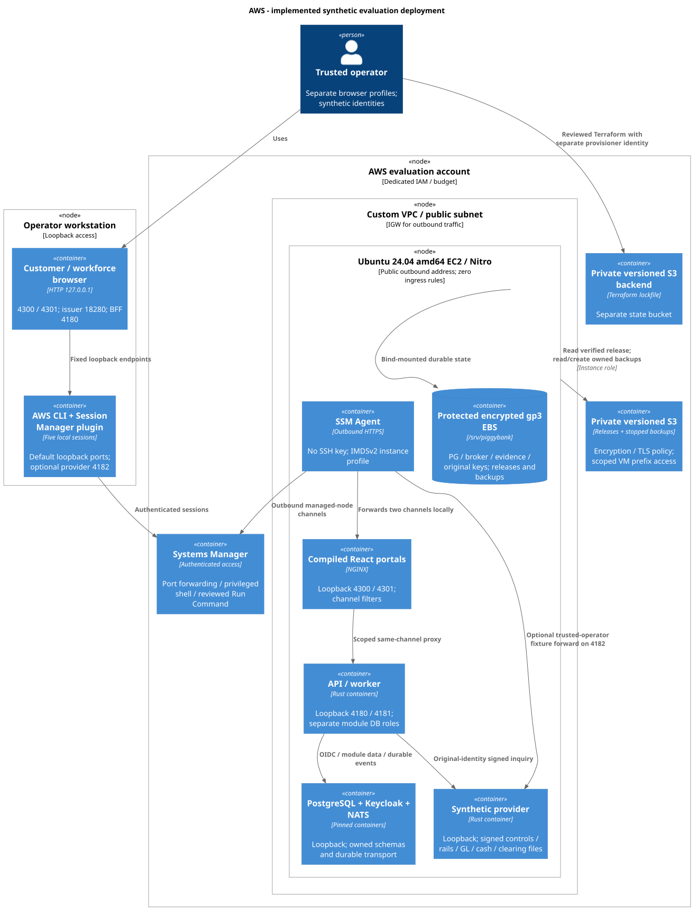

# Deploy Piggybank on AWS

Revision: 2026-11-03. Deploy from the repository root with Bash. This provisions one synthetic evaluation environment. Read the [deployment contract](../README.md) and [AWS operations/recovery procedure](OPERATIONS.md) first.



Editable [C4 PlantUML deployment](deployment-aws.puml).

Follow the [workstation installation steps](../PREREQUISITES.md) if the required tools are absent.

## 1. Prepare account, tools and permissions

Use an approved AWS account/region with quota for one x86_64 `m7i.xlarge`, 60 GB encrypted root EBS, 100 GB encrypted data EBS and a VPC. Set a budget notification before leaving the environment running. EC2, EBS, public IPv4, S3 versions/backups and outbound transfer can incur charges. Stopping the instance retains disks/storage charges; this package supplies no cost or capacity commitment.

Install Terraform 1.10+, AWS CLI v2, the Session Manager plugin, Python 3.11+, Bash and a Linux/amd64-capable Docker or Podman build engine. Use a federated provisioning role with EC2/VPC/EBS, IAM role/profile/policy, SSM public-parameter lookup and S3 bucket-policy/versioning permissions. The day-to-day operator role is separate. [AWS CLI installation](https://docs.aws.amazon.com/cli/latest/userguide/getting-started-install.html).

```sh
aws configure sso
aws sso login --profile YOUR_DEPLOYMENT_PROFILE
export AWS_PROFILE=YOUR_DEPLOYMENT_PROFILE
export AWS_REGION=us-east-1
export AWS_DEFAULT_REGION="$AWS_REGION"
export AWS_AVAILABILITY_ZONE=us-east-1a
export STATE_BUCKET=YOUR_GLOBALLY_UNIQUE_PIGGYBANK_TFSTATE
export ARTIFACT_BUCKET=YOUR_GLOBALLY_UNIQUE_PIGGYBANK_ARTIFACTS
export RELEASE=cloud-20261111-01
aws sts get-caller-identity
terraform version
session-manager-plugin --version
docker compose version
```

Expected: the intended account/role is displayed and tools succeed. The availability zone must belong to the selected region. Each environment needs a unique stack name/backend key; do not reuse GCP state.

## 2. Bootstrap private versioned buckets

```sh
bash infra/cloud/aws/bootstrap-state.sh
cat infra/cloud/aws/backend.hcl
```

Expected: separate state and artifact buckets owned by the active account, block-public-access enabled, versioning enabled, SSE-S3 encryption and a TLS-only bucket policy. The script supports the `us-east-1` create-bucket exception. Use dedicated new bucket names: it sets the complete bucket policy, so do not point it at a shared bucket with unrelated policies. Restrict bucket operators and preserve state/backup versions. These buckets are outside the application Terraform stack.

## 3. Build and upload the immutable release

```sh
# Reuse the delivered archive if present; new source changes require a new release ID.
if [ ! -f ".local/cloud/releases/$RELEASE.tgz" ]; then
  python3 infra/cloud/shared/package.py "$RELEASE" --runtime docker
fi
# For Podman, use --runtime podman. Reuse a previously built identical release across clouds.
(cd .local/cloud/releases && sha256sum -c "$RELEASE.tgz.sha256")
aws s3api put-object --bucket "$ARTIFACT_BUCKET" \
  --key "releases/$RELEASE.tgz" --body ".local/cloud/releases/$RELEASE.tgz" \
  --if-none-match '*' --server-side-encryption AES256
```

Expected: builds and checksum succeed and a new object is created. Choose a new release identifier rather than overwriting one. This `put-object` path supports archives up to S3's single-request limit of 5 GB; if a build exceeds that limit, use a unique never-before-used object with the CLI's multipart `aws s3 cp`, then retain its version ID and independent archive SHA256. Do not rely on an S3 ETag as the archive SHA256. [AWS upload limits](https://docs.aws.amazon.com/AmazonS3/latest/userguide/upload-objects.html). Record release object, version ID and exact checksum in your change record.

## 4. Set deployment inputs

```sh
cp infra/cloud/aws/terraform.tfvars.example infra/cloud/aws/terraform.tfvars
```

Edit the file with `region`, `availability_zone`, `name`, `artifact_bucket`, exact `release_object` and `release_sha256`. Keep `protect_vm = true`. Defaults use an encrypted gp3 data disk and Ubuntu 24.04 amd64. The AMI resolves Canonical's regional public SSM parameter and verifies Canonical ownership/architecture. For qualification, pin the accepted AMI with `ami_id` and retain it. [Canonical image parameter format](https://ubuntu.com/aws/docs/aws-how-to/instances/find-ubuntu-images/).

No application secrets belong in tfvars or user data. Review [main.tf](../../../infra/cloud/aws/main.tf), [startup](../../../infra/cloud/aws/startup.sh.tftpl) and [operator policy](../../../infra/cloud/aws/operator-policy.tf). The VM role reads releases, reads/writes only its own backup prefix and runs the SSM managed-node agent. It has no infrastructure provisioning permissions.

## 5. Initialize backend and validate

```sh
terraform -chdir=infra/cloud/aws init -reconfigure -backend-config=backend.hcl
terraform -chdir=infra/cloud/aws fmt -check
terraform -chdir=infra/cloud/aws validate
terraform -chdir=infra/cloud/aws test
```

Expected: private S3 backend configured with encryption and `use_lockfile = true`, signed locked provider installed, validation and mock plan successful. State operators need object permissions on the state key and Get/Put/Delete on its `.tflock` key. No DynamoDB table is required for this configured backend. [HashiCorp S3 backend reference](https://developer.hashicorp.com/terraform/language/backend/s3).

## 6. Review and apply

```sh
terraform -chdir=infra/cloud/aws plan -out=deployment.tfplan
terraform -chdir=infra/cloud/aws show deployment.tfplan
terraform -chdir=infra/cloud/aws apply deployment.tfplan
terraform -chdir=infra/cloud/aws output
export AWS_INSTANCE_ID=$(terraform -chdir=infra/cloud/aws output -raw instance_id)
```

Review: one dedicated VPC/public subnet/Internet Gateway, an instance with **no ingress rules**, no SSH key, IMDSv2, encrypted root and separately protected data volume. A public address supplies outbound access to registries and SSM; application sockets remain loopback. The volume attachment may complete after cloud-init starts; startup waits for the exact Nitro NVMe by-id device before any mount/format.

Expected: instance, IAM profile and data attachment exist. Terraform finishing does not mean the application is ready. Cloud-init installs Docker/Compose, verifies the artifact, initializes credentials/roles, migrates and starts the synthetic services. If apply partially fails, inspect state and re-plan; do not delete the data volume to retry.

## 7. Grant the designated operations role

Use the provisioning principal to attach the generated instance-scoped policy to your existing designated operator role:

```sh
export AWS_OPERATOR_ROLE=YOUR_EXISTING_OPERATIONS_ROLE
mkdir -p .local/cloud
terraform -chdir=infra/cloud/aws output -raw operator_policy_json > .local/cloud/aws-operator-policy.json
aws iam put-role-policy --role-name "$AWS_OPERATOR_ROLE" \
  --policy-name piggybank-evaluation-operations \
  --policy-document file://.local/cloud/aws-operator-policy.json
```

Then authenticate as that operator role. Its policy permits Session Manager shell/port sessions and `AWS-RunShellScript` only against this instance, plus status reads. Regenerate it if the instance is replaced. The policy also permits the operator to open data channels and terminate/resume only their own sessions. [AWS session IAM examples](https://docs.aws.amazon.com/systems-manager/latest/userguide/getting-started-restrict-access-quickstart.html). Session shell/Run Command provides privileged host administration; assign only trusted operators. Organization policies and permission boundaries may require an administrator to attach this reviewed policy through their normal process.

## 8. Wait for SSM and first-boot acceptance

```sh
aws ssm describe-instance-information \
  --filters "Key=InstanceIds,Values=$AWS_INSTANCE_ID" \
  --query 'InstanceInformationList[].{Id:InstanceId,Status:PingStatus}'
python3 infra/cloud/aws/command.py infra/cloud/aws/status.sh
```

Expected: SSM shows `Online`; the command waits for cloud-init and returns actual success only when the systemd unit and all smoke checks pass. Run Command output is retained by SSM, so do not put passwords, session tokens or full environment files in command scripts. If SSM is offline, check the profile, outbound HTTPS/DNS route and cloud-init console output. See [troubleshooting](OPERATIONS.md#troubleshooting).

## 9. Open all five local tunnels

Ensure workstation ports 4180, 4181, 4300, 4301 and 18280 are free; stop the local Piggybank runtime if necessary. In a dedicated terminal:

```sh
bash infra/cloud/aws/tunnel.sh
```

The script starts five `AWS-StartPortForwardingSession` processes and closes the bundle when any session ends. Keep this terminal running and reconnect the bundle after expired sessions. Retain the original local port numbers and use `127.0.0.1` in the browser. The CLI requires the Session Manager plugin and a suitable SSM Agent version. [AWS port-forwarding instructions](https://docs.aws.amazon.com/systems-manager/latest/userguide/session-manager-working-with-sessions-start.html).

## 10. Verify portals and identity

```sh
curl --fail http://127.0.0.1:4180/health/ready
curl --fail http://127.0.0.1:4181/health/ready
curl --fail http://127.0.0.1:18280/realms/customers/.well-known/openid-configuration
# Separate interactive shell, not Run Command, for private credential retrieval:
aws ssm start-session --target "$AWS_INSTANCE_ID" --region "$AWS_REGION"
```

In the privileged session, privately retrieve only `BANK_FIXTURE_PASSWORD` from `/srv/piggybank/state/.env`. All synthetic fixture users share this per-install random password. It differs from local development. Do not export the full environment file or put the password into Run Command output or tickets. Apply your organization's session-logging policy when handling credentials.

In that private interactive host session, this prints only the fixture password:

```sh
sudo awk -F= '$1 == "BANK_FIXTURE_PASSWORD" { print $2 }' /srv/piggybank/state/.env
```


Open `http://127.0.0.1:4300` as `alice`/`bob` and `http://127.0.0.1:4301` as `reviewer`, `approver` or `security`. Use independent browser profiles for maker/checker and for different environments. Confirm login/callback/logout and permitted staff tools. Reviewer/approver have independent canonical identities; security alone has no Finance inquiry. Catalog/chart fixtures are present, while funded balances and fresh liquidity evidence are not fabricated. Fixture authorities expire after 365 days, and product/chart validity retains its explicit 2030 cutoff.

For an authenticated native-basis scenario after deployment, follow the [periodic policy publication runbook](../../runbooks/periodic-accounting-policies.md), then the [native basis runbook](../../runbooks/periodic-native-basis.md). Use this installation's fixture password, a registered matching account and actual covered UTC dates. Expected: immutable original replay, fresh observation after later facts, distinct historical/current positions and read-only checker access; no periodic journal or enrollment. Record this functional result separately from infrastructure smoke.

## 11. Complete acceptance and handoff

- [ ] Intended account/region/instance/AMI, object version and SHA256 recorded.
- [ ] Empty ingress security group, no SSH key and required IMDSv2 confirmed.
- [ ] Encrypted data volume is mounted and retained independently of the instance.
- [ ] Real-VM API/worker dependencies, portals, provider and six channel-denial checks passed.
- [ ] Both browser OIDC contexts, distinct maker/checker and restart persistence checked.
- [ ] Complete stopped backup exported and separately restored in a recovery drill.
- [ ] Owner, billing budget, backup cadence/retention and failure-notification process assigned.
- [ ] Live-cloud evidence recorded separately from [local validation](../VALIDATION.md).

Continue with [AWS operations](OPERATIONS.md) for upgrades, recovery, rollback and removal. These files have not been applied to your AWS account.
