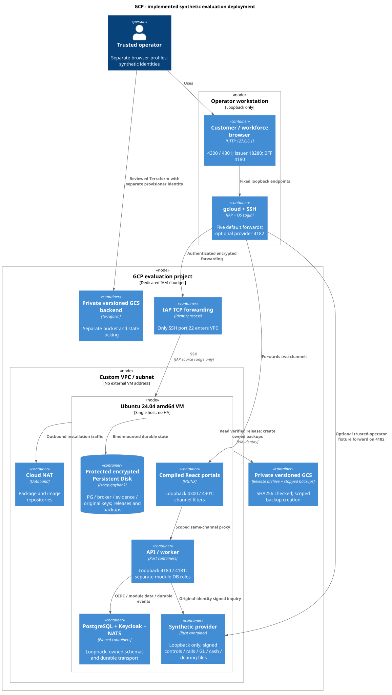

# Deploy Piggybank on GCP

Revision: 2026-11-03. Deploy from the repository root with Bash. This procedure provisions a single synthetic evaluation environment. Read the [deployment contract](../README.md) and [operations/restore runbook](OPERATIONS.md) before applying resources.



Editable [C4 PlantUML deployment](deployment-gcp.puml).

Follow the [workstation installation steps](../PREREQUISITES.md) if the required tools are absent.

## 1. Prepare the account, operator and tools

Use a billed GCP project with an approved region and quota for one `e2-standard-4` VM, 60 GB boot disk, 100 GB data disk and Cloud NAT. Set a budget notification in the billing console before a long-running evaluation. VM, disks, snapshots/backups, bucket versions, outbound traffic and Cloud NAT incur charges even with no application users; stopping the VM retains disk/storage/NAT costs. Choose sizes through your own capacity checks rather than interpreting defaults as a service-level commitment.

Install Terraform 1.10+, Google Cloud CLI, Python 3.11+, Bash and a Linux/amd64-capable Docker or Podman build engine. Initial Rust builds need several GB of free storage and network access to official registries/package repositories. Authenticate an infrastructure provisioning principal authorized to enable services, manage Compute/VPC/NAT/firewalls/disks, service accounts, bucket access policies and IAP/OS Login grants. Keep daily operators separate from this principal.

```sh
gcloud auth login
gcloud auth application-default login
export GCP_PROJECT=YOUR_BILLED_PROJECT_ID
export GCP_REGION=us-central1
export GCP_ZONE=us-central1-a
export GCP_INSTANCE=piggybank-eval
export STATE_BUCKET=YOUR_GLOBALLY_UNIQUE_PIGGYBANK_TFSTATE
export ARTIFACT_BUCKET=YOUR_GLOBALLY_UNIQUE_PIGGYBANK_ARTIFACTS
export RELEASE=cloud-20261115-01
gcloud config set project "$GCP_PROJECT"
gcloud projects describe "$GCP_PROJECT"
terraform version
docker compose version
```

Expected: the intended project is displayed and all tools succeed. The zone must belong to the selected region. Use a separate state prefix/name/project for each environment. Do not reuse the same state across AWS and GCP.

## 2. Create private versioned state and artifact buckets

```sh
bash infra/cloud/gcp/bootstrap-state.sh
cat infra/cloud/gcp/backend.hcl
```

Expected: both buckets exist in the intended project, versioning is enabled, public access prevention and uniform access apply, and `backend.hcl` names only the state bucket/prefix. The script refuses a pre-existing global name belonging to another project. State and artifacts are separate buckets; restrict access to designated infrastructure operators. Bucket bootstrap is intentionally outside the application Terraform state, so destroying compute cannot delete state or backups.

## 3. Build and upload one immutable release

```sh
# Reuse the delivered archive if present; new source changes require a new release ID.
if [ ! -f ".local/cloud/releases/$RELEASE.tgz" ]; then
  python3 infra/cloud/shared/package.py "$RELEASE" --runtime docker
fi
# For Podman, replace --runtime docker with --runtime podman.
(cd .local/cloud/releases && sha256sum -c "$RELEASE.tgz.sha256")
gcloud storage cp --if-generation-match=0 \
  ".local/cloud/releases/$RELEASE.tgz" \
  "gs://$ARTIFACT_BUCKET/releases/$RELEASE.tgz"
```

Expected: Rust and TypeScript builds succeed, the checksum is OK and the object is newly created. Do not overwrite an existing release; choose a new identifier. Record the full archive SHA256 in the deployment change record. The upload contains application images and templates, not runtime credentials. Keep the original release archive for recovery.

## 4. Configure Terraform

```sh
cp infra/cloud/gcp/terraform.tfvars.example infra/cloud/gcp/terraform.tfvars
```

Edit `terraform.tfvars`: set `project_id`, `region`, `zone`, `name`, `artifact_bucket`, `release_object = "releases/<your-release>.tgz"`, and the exact SHA256 from step 3. Keep `protect_vm = true`. The GCP name is 3–24 lowercase characters. No password, token or cloud credential belongs in this file. Review [main.tf](../../../infra/cloud/gcp/main.tf) and [startup template](../../../infra/cloud/gcp/startup.sh.tftpl).

## 5. Initialize and validate the real backend

```sh
terraform -chdir=infra/cloud/gcp init -reconfigure -backend-config=backend.hcl
terraform -chdir=infra/cloud/gcp fmt -check
terraform -chdir=infra/cloud/gcp validate
terraform -chdir=infra/cloud/gcp test
```

Expected: backend initialization succeeds, provider signatures/lockfile are accepted, configuration validates and the mock plan passes. The mock proves configured isolation/protection properties; it does not validate live IAM, quotas or image availability. Keep `.terraform.lock.hcl` in the reviewed source distribution. GCS supports Terraform state locking. [Backend reference](https://developer.hashicorp.com/terraform/language/backend/gcs).

## 6. Review and apply infrastructure

```sh
terraform -chdir=infra/cloud/gcp plan -out=deployment.tfplan
terraform -chdir=infra/cloud/gcp show deployment.tfplan
terraform -chdir=infra/cloud/gcp apply deployment.tfplan
terraform -chdir=infra/cloud/gcp output
```

Review the plan for the intended project/zone, no public VM IP, a single protected data disk, an IAP source-only TCP/22 firewall and artifact-only VM identity plus scoped backup creation. Terraform apply starts installation but does not wait for application acceptance. The VM retrieves the archive using its service account, verifies SHA256, mounts the designated ext4 disk, loads images, generates credentials, migrates, configures identity and starts the stack.

Expected infrastructure: VM/private IP, attached data disk, Cloud NAT, custom VPC/subnet and dedicated service account. If apply fails, inspect the original state and partial resources; re-run plan instead of deleting persistent disks.

## 7. Grant the designated operator access

As the IAM provisioning principal, set the intended user/group and grant scoped operational access:

```sh
export GCP_OPERATOR_MEMBER='user:operator@example.com'
gcloud projects add-iam-policy-binding "$GCP_PROJECT" \
  --member="$GCP_OPERATOR_MEMBER" --role=roles/iap.tunnelResourceAccessor
gcloud projects add-iam-policy-binding "$GCP_PROJECT" \
  --member="$GCP_OPERATOR_MEMBER" --role=roles/compute.osAdminLogin
gcloud projects add-iam-policy-binding "$GCP_PROJECT" \
  --member="$GCP_OPERATOR_MEMBER" --role=roles/compute.viewer
VM_SA=$(terraform -chdir=infra/cloud/gcp output -raw service_account)
gcloud iam service-accounts add-iam-policy-binding "$VM_SA" \
  --project "$GCP_PROJECT" --member="$GCP_OPERATOR_MEMBER" --role=roles/iam.serviceAccountUser
```

These project-level operator grants are appropriate for a dedicated evaluation project; narrow them further for shared projects. Organization/external-user OS Login requirements may add an organization-level grant. GCP IAP requires the `35.235.240.0/20` firewall range for IPv4 SSH forwarding. The VM itself has no external IP. [Google's IAP/OS Login guidance](https://docs.cloud.google.com/iap/docs/using-tcp-forwarding).

## 8. Wait for first-boot acceptance

```sh
gcloud compute ssh "$GCP_INSTANCE" --project "$GCP_PROJECT" --zone "$GCP_ZONE" \
  --tunnel-through-iap --command='sudo journalctl -u google-startup-scripts.service -n 120 --no-pager'
gcloud compute ssh "$GCP_INSTANCE" --project "$GCP_PROJECT" --zone "$GCP_ZONE" \
  --tunnel-through-iap --command='sudo systemctl status piggybank --no-pager; sudo piggybank status'
```

Expected: `piggybank.service` is active and all smoke checks pass: API/worker readiness has PostgreSQL, JetStream and OIDC all true; both static portals load; provider responds; six cross-channel/canonical-path requests return 403. Download/build startup duration depends on network and package repositories. If the unit is absent or failed, use [troubleshooting](OPERATIONS.md#troubleshooting) rather than interpreting a running VM as successful deployment.

## 9. Open the five operator tunnels

Stop local processes using ports 4180, 4181, 4300, 4301 and 18280. Run this in a dedicated terminal:

```sh
bash infra/cloud/gcp/tunnel.sh
```

Keep it running. All forwards explicitly bind workstation loopback. A separate browser profile avoids old local sessions. Do not change `127.0.0.1` to `localhost`, issuer ports or callback origins.

## 10. Verify browser and identity behavior

In a second terminal:

```sh
curl --fail http://127.0.0.1:4180/health/ready
curl --fail http://127.0.0.1:4181/health/ready
curl --fail http://127.0.0.1:18280/realms/customers/.well-known/openid-configuration
```

Open `http://127.0.0.1:4300` and `http://127.0.0.1:4301`. The bootstrap creates customers `alice`/`bob` and workforce users `reviewer`/`approver`/`security`. All fixture users receive one per-install random password. Retrieve it privately through an interactive IAP SSH session with `sudo` by reading only `BANK_FIXTURE_PASSWORD` from `/srv/piggybank/state/.env`. It is not the local development password. Never paste the file, its other credentials or login tokens into tickets/logs. Use separate browser profiles for maker/checker.

In that private interactive host session, this prints only the fixture password:

```sh
sudo awk -F= '$1 == "BANK_FIXTURE_PASSWORD" { print $2 }' /srv/piggybank/state/.env
```


Expected: customer login returns to the customer channel; reviewer sees permitted staff tools; approver is a distinct canonical person; security alone does not gain Finance inquiry. Open catalog and Finance/chart inquiry. There are no fabricated funded accounts or fresh liquidity values: use existing synthetic journey runbooks for business scenarios. Role grants initially expire after 365 days; product/chart fixtures have their explicit 2030 cutoff. Do not silently extend them through reseeding.

For an authenticated native-basis scenario after deployment, follow the [periodic policy publication runbook](../../runbooks/periodic-accounting-policies.md), then the [native basis runbook](../../runbooks/periodic-native-basis.md). Use this installation's fixture password, a registered matching account and actual covered UTC dates. Expected: immutable original replay, fresh observation after later facts, distinct historical/current positions and read-only checker access; no periodic journal or enrollment. Record this functional result separately from infrastructure smoke.

Verify the [Finance audit delivery workflow](../../runbooks/finance-audit-delivery.md) after deployment. Expected: retained pending records, original native receipt recovery and a read-only checker view. Schema 52 refuses legacy delivery flags without original matching Controls evidence; investigate a refused upgrade without manufacturing receipts.

Follow the [customer periodic disclosure runbook](../../runbooks/customer-periodic-disclosures.md) to verify exact approved rule information for an owned account, saved URLs and private approval-data redaction. Reading must not enroll the account or enable a financial posting.

On schema 53, follow the [retained preview review runbook](../../runbooks/periodic-preview-reviews.md). Explicit acknowledgment retains exact historical material and original identity/receipt evidence. Verify original-key recovery and saved-proof inquiry; this workflow does not establish financial consent, enrollment or activation.

## 11. Record completion

- [ ] Intended project, region, instance and archive SHA256 recorded.
- [ ] No external VM IP or public application ingress.
- [ ] API/worker dependency readiness and channel-denial smoke passed on the real VM.
- [ ] Both OIDC browser trust contexts and distinct maker/checker checked manually.
- [ ] Disk persists through an approved restart and the same release resumes.
- [ ] Stopped backup uploaded off-host and a separate restore drill completed.
- [ ] Owner, budget, backup cadence, retention and failure-notification process assigned.
- [ ] All real-cloud results recorded separately from [local validation](../VALIDATION.md).

Follow [GCP operations](OPERATIONS.md) for upgrades, backup/restore, rollback and teardown. The supplied files have not themselves been applied to your GCP project.
