# Digital Bank — C4 and UML Diagram Catalog

**Status:** Proposed design, 2026-10-22. All 22 views derive from the supplied capability image plus explicitly proposed requirements. The C4 L4 view is a design-level class proposal, not generated source code.

Read with the [PRD](../PRD.md), [architecture](../ARCHITECTURE.md) and [traceability](../TRACEABILITY.md). Editable `.puml` files are canonical; this gallery embeds their complete PlantUML notation and rendered SVG previews. Expand a source block or open the linked file to inspect details.

C4 containers represent deployable applications/data stores. L3 components remain inside one container. The source image's L2 badges are independent of C4 zoom levels. Arrows are directed and labeled; actors/providers are outside the owned system boundary unless explicitly shown otherwise.

## Rendering

Run `make docs` from the repository root to render, synchronize and validate everything. `make diagrams` renders SVG and refreshes this catalog; `make check` checks the catalog, local Markdown references, requirement/scenario coverage and PlantUML syntax. Prerequisites: Python 3.10+, Java 17+, Graphviz `dot`, and `make`.

The renderer uses official PlantUML **1.2026.9**, SHA-256 `aa4a1d06f8911c4b842beff4828dd955be431692b631a312d04c0e9fab9581de`, cached under `.cache/`. First use requires network access to its [official release](https://github.com/plantuml/plantuml/releases/tag/v1.2026.9); cached execution needs no network. C4 notation comes from the library bundled in that pinned JAR, with `!include <C4/...>` rather than remote includes.

The shared [theme](theme.puml) is resolved relative to each source. Render canonical files through the provided command so includes remain correct. The fenced blocks below are exact source listings for reading; when copying to another directory, preserve the relative theme path or adjust it. Preview SVGs can be opened independently and do not need a PlantUML extension.

Notation references: [official C4 views](https://c4model.com/diagrams.html), [C4-PlantUML](https://github.com/plantuml-stdlib/C4-PlantUML), [PlantUML command line](https://plantuml.com/command-line).

## Index

| View | Editable source | Rendered SVG |
| --- | --- | --- |
| C4 L1 — System context | [PlantUML](c4/01-context.puml) | [SVG](rendered/01-context.svg) |
| C4 L2 — Containers and data ownership | [PlantUML](c4/02-containers.puml) | [SVG](rendered/02-containers.svg) |
| C4 L3 — Journey process components | [PlantUML](c4/03-onboarding-components.puml) | [SVG](rendered/03-onboarding-components.svg) |
| C4 L3 — Core components | [PlantUML](c4/04-core-components.puml) | [SVG](rendered/04-core-components.svg) |
| C4 L3 — Payment components | [PlantUML](c4/05-payments-components.puml) | [SVG](rendered/05-payments-components.svg) |
| C4 L3 — Control components | [PlantUML](c4/06-controls-components.puml) | [SVG](rendered/06-controls-components.svg) |
| C4 L4 — Payment code design | [PlantUML](c4/07-payment-code.puml) | [SVG](rendered/07-payment-code.svg) |
| C4 dynamic — Payment flow | [PlantUML](c4/08-payment-dynamic.puml) | [SVG](rendered/08-payment-dynamic.svg) |
| C4 deployment — Production and recovery | [PlantUML](c4/09-deployment.puml) | [SVG](rendered/09-deployment.svg) |
| UML — Use cases | [PlantUML](uml/01-use-cases.puml) | [SVG](rendered/01-use-cases.svg) |
| UML — Domain model | [PlantUML](uml/02-domain-model.puml) | [SVG](rendered/02-domain-model.svg) |
| UML — Onboarding sequence | [PlantUML](uml/03-onboarding-sequence.puml) | [SVG](rendered/03-onboarding-sequence.svg) |
| UML — Account opening activity | [PlantUML](uml/04-account-opening-activity.puml) | [SVG](rendered/04-account-opening-activity.svg) |
| UML — Payment sequence | [PlantUML](uml/05-payment-sequence.puml) | [SVG](rendered/05-payment-sequence.svg) |
| UML — Reconciliation sequence | [PlantUML](uml/06-reconciliation-sequence.puml) | [SVG](rendered/06-reconciliation-sequence.svg) |
| UML — Payment state machine | [PlantUML](uml/07-payment-state.puml) | [SVG](rendered/07-payment-state.svg) |
| UML — Application state machine | [PlantUML](uml/08-application-state.puml) | [SVG](rendered/08-application-state.svg) |
| UML — Account state machine | [PlantUML](uml/09-account-state.puml) | [SVG](rendered/09-account-state.svg) |
| UML — Exception activity | [PlantUML](uml/10-exception-activity.puml) | [SVG](rendered/10-exception-activity.svg) |
| UML — Event integration components | [PlantUML](uml/11-event-components.puml) | [SVG](rendered/11-event-components.svg) |
| UML — Authorization sequence | [PlantUML](uml/12-authorization-sequence.puml) | [SVG](rendered/12-authorization-sequence.svg) |
| UML — Document sequence | [PlantUML](uml/13-document-sequence.puml) | [SVG](rendered/13-document-sequence.svg) |

## C4 L1 — System context

System scope, people and external providers; J-01–J-08.

[Editable PlantUML](c4/01-context.puml) · [Open SVG](rendered/01-context.svg)

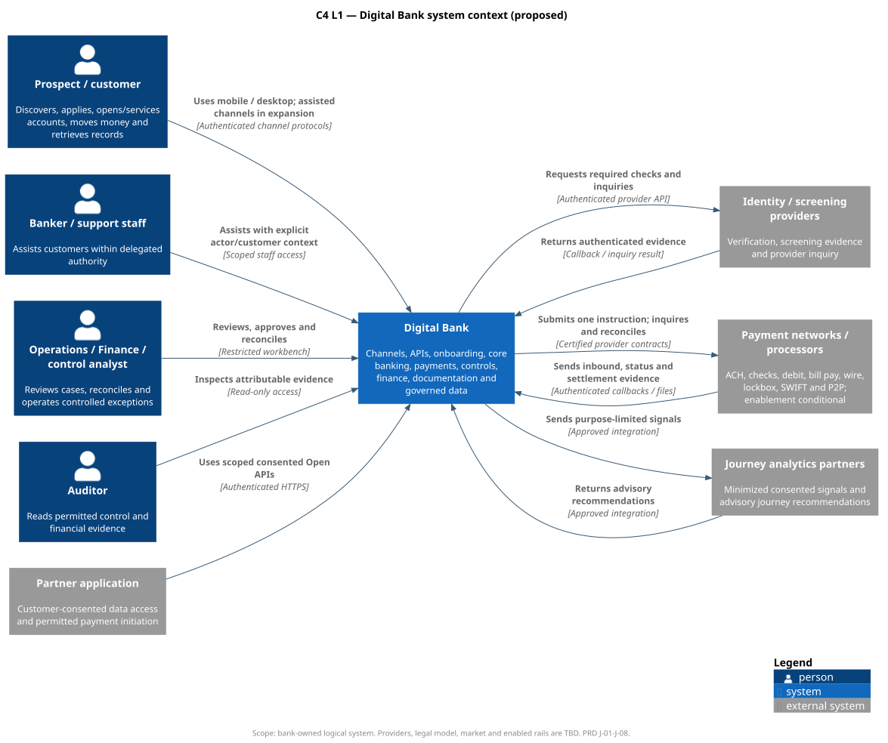

<details>
<summary>Complete PlantUML source</summary>

```plantuml
@startuml
!include <C4/C4_Context>
!include ../theme.puml
LAYOUT_LEFT_RIGHT()
title C4 L1 — Digital Bank system context (proposed)

Person(customer, "Prospect / customer", "Discovers, applies, opens/services accounts, moves money and retrieves records")
Person(banker, "Banker / support staff", "Assists customers within delegated authority")
Person(operator, "Operations / Finance / control analyst", "Reviews cases, reconciles and operates controlled exceptions")
Person(auditor, "Auditor", "Reads permitted control and financial evidence")
System(bank, "Digital Bank", "Channels, APIs, onboarding, core banking, payments, controls, finance, documentation and governed data")
System_Ext(partner, "Partner application", "Customer-consented data access and permitted payment initiation")
System_Ext(identity, "Identity / screening providers", "Verification, screening evidence and provider inquiry")
System_Ext(rails, "Payment networks / processors", "ACH, checks, debit, bill pay, wire, lockbox, SWIFT and P2P; enablement conditional")
System_Ext(journeys, "Journey analytics partners", "Minimized consented signals and advisory journey recommendations")
Rel(customer, bank, "Uses mobile / desktop; assisted channels in expansion", "Authenticated channel protocols")
Rel(banker, bank, "Assists with explicit actor/customer context", "Scoped staff access")
Rel(operator, bank, "Reviews, approves and reconciles", "Restricted workbench")
Rel(auditor, bank, "Inspects attributable evidence", "Read-only access")
Rel(partner, bank, "Uses scoped consented Open APIs", "Authenticated HTTPS")
Rel(bank, identity, "Requests required checks and inquiries", "Authenticated provider API")
Rel(identity, bank, "Returns authenticated evidence", "Callback / inquiry result")
Rel(bank, rails, "Submits one instruction; inquires and reconciles", "Certified provider contracts")
Rel(rails, bank, "Sends inbound, status and settlement evidence", "Authenticated callbacks / files")
Rel(bank, journeys, "Sends purpose-limited signals", "Approved integration")
Rel(journeys, bank, "Returns advisory recommendations", "Approved integration")
SHOW_LEGEND()
footer Scope: bank-owned logical system. Providers, legal model, market and enabled rails are TBD. PRD J-01–J-08.
@enduml
```

</details>

## C4 L2 — Containers and data ownership

Proposed deployables, owned stores, principal calls and events; all capability groups.

[Editable PlantUML](c4/02-containers.puml) · [Open SVG](rendered/02-containers.svg)

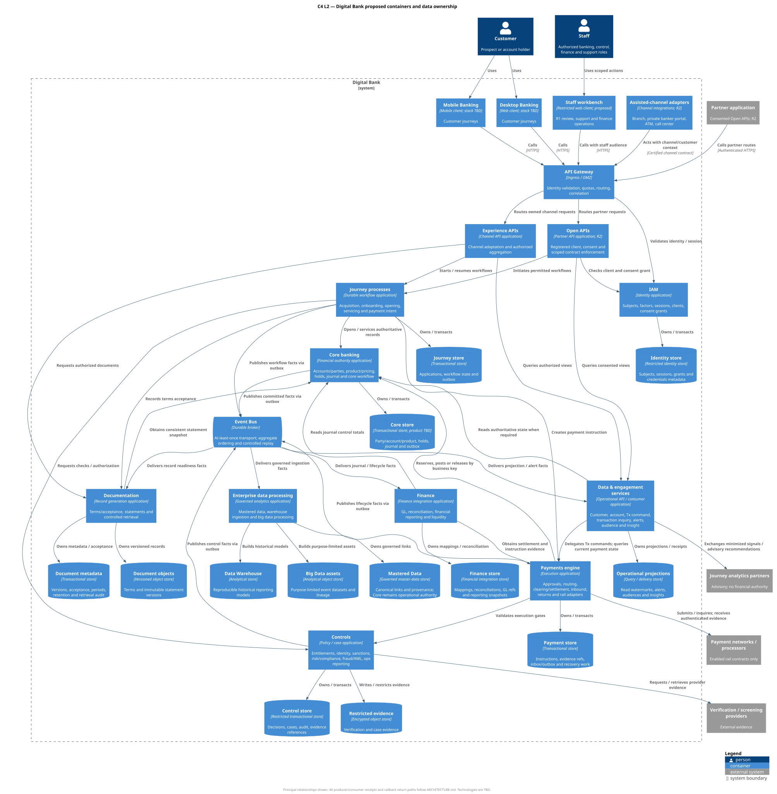

<details>
<summary>Complete PlantUML source</summary>

```plantuml
@startuml
!include <C4/C4_Container>
!include ../theme.puml
LAYOUT_TOP_DOWN()
title C4 L2 — Digital Bank proposed containers and data ownership

Person(customer, "Customer", "Prospect or account holder")
Person(operator, "Staff", "Authorized banking, control, finance and support roles")
System_Ext(partner, "Partner application", "Consented Open APIs; R2")
System_Ext(rails, "Payment networks / processors", "Enabled rail contracts only")
System_Ext(verification, "Verification / screening providers", "External evidence")
System_Ext(journeyPartner, "Journey analytics partners", "Advisory; no financial authority")

System_Boundary(bank, "Digital Bank") {
  Container(mobile, "Mobile Banking", "Mobile client; stack TBD", "Customer journeys")
  Container(web, "Desktop Banking", "Web client; stack TBD", "Customer journeys")
  Container(staff, "Staff workbench", "Restricted web client; proposed", "R1 review, support and finance operations")
  Container(assisted, "Assisted-channel adapters", "Channel integrations; R2", "Branch, private banker portal, ATM, call center")
  Container(gateway, "API Gateway", "Ingress / DMZ", "Identity validation, quotas, routing, correlation")
  Container(experience, "Experience APIs", "Channel API application", "Channel adaptation and authorized aggregation")
  Container(openapi, "Open APIs", "Partner API application; R2", "Registered client, consent and scoped contract enforcement")
  Container(iam, "IAM", "Identity application", "Subjects, factors, sessions, clients, consent grants")
  Container(journey, "Journey processes", "Durable workflow application", "Acquisition, onboarding, opening, servicing and payment intent")
  Container(core, "Core banking", "Financial authority application", "Accounts/parties, product/pricing, holds, journal and core workflow")
  Container(payments, "Payments engine", "Execution application", "Approvals, routing, clearing/settlement, inbound, returns and rail adapters")
  Container(controls, "Controls", "Policy / case application", "Entitlements, identity, sanctions, risk/compliance, fraud/AML, ops reporting")
  Container(data, "Data & engagement services", "Operational API / consumer application", "Customer, account, Tx command, transaction inquiry, alerts, audience and insight")
  Container(finance, "Finance", "Finance integration application", "GL, reconciliation, financial reporting and liquidity")
  Container(documents, "Documentation", "Record generation application", "Terms/acceptance, statements and controlled retrieval")
  Container(analytics, "Enterprise data processing", "Governed analytics application", "Mastered data, warehouse ingestion and big data processing")
  ContainerQueue(bus, "Event Bus", "Durable broker", "At-least-once transport; aggregate ordering and controlled replay")
  ContainerDb(coreDb, "Core store", "Transactional store; product TBD", "Party/account/product, holds, journal and outbox")
  ContainerDb(paymentDb, "Payment store", "Transactional store", "Instructions, evidence refs, inbox/outbox and recovery work")
  ContainerDb(journeyDb, "Journey store", "Transactional store", "Applications, workflow state and outbox")
  ContainerDb(controlDb, "Control store", "Restricted transactional store", "Decisions, cases, audit, evidence references")
  ContainerDb(iamDb, "Identity store", "Restricted identity store", "Subjects, sessions, grants and credentials metadata")
  ContainerDb(projectionDb, "Operational projections", "Query / delivery store", "Read watermarks, alerts, audiences and insights")
  ContainerDb(financeDb, "Finance store", "Financial integration store", "Mappings, reconciliations, GL refs and reporting snapshots")
  ContainerDb(documentDb, "Document metadata", "Transactional store", "Versions, acceptance, periods, retention and retrieval audit")
  ContainerDb(evidenceStore, "Restricted evidence", "Encrypted object store", "Verification and case evidence")
  ContainerDb(documentStore, "Document objects", "Versioned object store", "Terms and immutable statement versions")
  ContainerDb(masterData, "Mastered Data", "Governed master-data store", "Canonical links and provenance; Core remains operational authority")
  ContainerDb(warehouse, "Data Warehouse", "Analytical store", "Reproducible historical reporting models")
  ContainerDb(dataLake, "Big Data assets", "Analytical object store", "Purpose-limited event datasets and lineage")
}
Rel(customer, mobile, "Uses")
Rel(customer, web, "Uses")
Rel(operator, staff, "Uses scoped actions")
Rel(mobile, gateway, "Calls", "HTTPS")
Rel(web, gateway, "Calls", "HTTPS")
Rel(staff, gateway, "Calls with staff audience", "HTTPS")
Rel(assisted, gateway, "Acts with channel/customer context", "Certified channel contract")
Rel(partner, gateway, "Calls partner routes", "Authenticated HTTPS")
Rel(gateway, iam, "Validates identity / session")
Rel(gateway, experience, "Routes owned channel requests")
Rel(gateway, openapi, "Routes partner requests")
Rel(openapi, iam, "Checks client and consent grant")
Rel(experience, journey, "Starts / resumes workflows")
Rel(openapi, journey, "Initiates permitted workflows")
Rel(experience, data, "Queries authorized views")
Rel(openapi, data, "Queries consented views")
Rel(journey, controls, "Requests checks / authorization")
Rel(journey, core, "Opens / services authoritative records")
Rel(journey, payments, "Creates payment instruction")
Rel(journey, documents, "Records terms acceptance")
Rel(data, core, "Reads authoritative state when required")
Rel(data, payments, "Delegates Tx commands; queries current payment state")
Rel(payments, controls, "Validates execution gates")
Rel(payments, core, "Reserves, posts or releases by business key")
Rel(payments, rails, "Submits / inquires; receives authenticated evidence")
Rel(controls, verification, "Requests / retrieves provider evidence")
Rel(finance, core, "Reads journal control totals")
Rel(finance, payments, "Obtains settlement and instruction evidence")
Rel(documents, core, "Obtains consistent statement snapshot")
Rel(experience, documents, "Requests authorized documents")
Rel(data, journeyPartner, "Exchanges minimized signals / advisory recommendations")
Rel(core, coreDb, "Owns / transacts")
Rel(payments, paymentDb, "Owns / transacts")
Rel(journey, journeyDb, "Owns / transacts")
Rel(controls, controlDb, "Owns / transacts")
Rel(controls, evidenceStore, "Writes / restricts evidence")
Rel(iam, iamDb, "Owns / transacts")
Rel(data, projectionDb, "Owns projections / receipts")
Rel(finance, financeDb, "Owns mappings / reconciliation")
Rel(documents, documentDb, "Owns metadata / acceptance")
Rel(documents, documentStore, "Owns versioned records")
Rel(analytics, masterData, "Owns governed links")
Rel(analytics, warehouse, "Builds historical models")
Rel(analytics, dataLake, "Builds purpose-limited assets")
Rel(core, bus, "Publishes committed facts via outbox")
Rel(payments, bus, "Publishes lifecycle facts via outbox")
Rel(journey, bus, "Publishes workflow facts via outbox")
Rel(controls, bus, "Publishes control facts via outbox")
Rel(bus, data, "Delivers projection / alert facts")
Rel(bus, finance, "Delivers journal / lifecycle facts")
Rel(bus, documents, "Delivers record readiness facts")
Rel(bus, analytics, "Delivers governed ingestion facts")
SHOW_LEGEND()
footer Principal relationships shown. All producer/consumer receipts and callback return paths follow ARCHITECTURE.md. Technologies are TBD.
@enduml
```

</details>

## C4 L3 — Journey process components

Acquisition, onboarding, opening, servicing and durable orchestration; FR-ACQ, FR-ONB, FR-ACC.

[Editable PlantUML](c4/03-onboarding-components.puml) · [Open SVG](rendered/03-onboarding-components.svg)

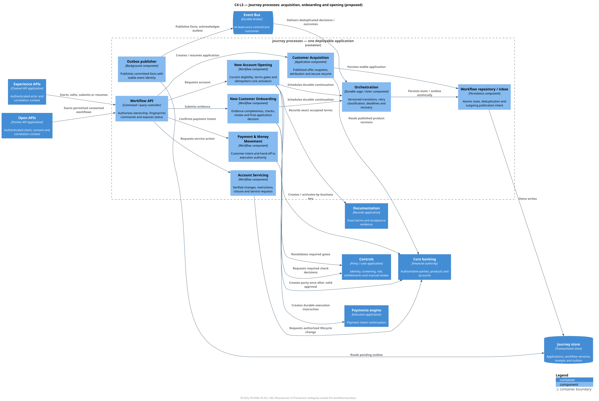

<details>
<summary>Complete PlantUML source</summary>

```plantuml
@startuml
!include <C4/C4_Component>
!include ../theme.puml
LAYOUT_LEFT_RIGHT()
title C4 L3 — Journey processes: acquisition, onboarding and opening (proposed)
Container(experience, "Experience APIs", "Channel API application", "Authenticated actor and correlation context")
Container(openapi, "Open APIs", "Partner API application", "Authenticated client, consent and correlation context")
Container(controls, "Controls", "Policy / case application", "Identity, screening, risk, entitlements and manual review")
Container(core, "Core banking", "Financial authority", "Authoritative parties, products and accounts")
Container(documents, "Documentation", "Records application", "Exact terms and acceptance evidence")
Container(payments, "Payments engine", "Execution application", "Payment intent continuation")
ContainerDb(journeyDb, "Journey store", "Transactional store", "Applications, workflow versions, receipts and outbox")
ContainerQueue(bus, "Event Bus", "Durable broker", "At-least-once control/core outcomes")
Container_Boundary(journey, "Journey processes — one deployable application") {
  Component(api, "Workflow API", "Command / query controller", "Authorizes ownership, fingerprints commands and exposes status")
  Component(acquisition, "Customer Acquisition", "Application component", "Published offer snapshot, attribution and secure resume")
  Component(onboarding, "New Customer Onboarding", "Workflow component", "Evidence completeness, checks, review and final application decision")
  Component(opening, "New Account Opening", "Workflow component", "Current eligibility, terms gates and idempotent core activation")
  Component(servicing, "Account Servicing", "Workflow component", "Verified changes, restrictions, closure and service requests")
  Component(paymentIntent, "Payment & Money Movement", "Workflow component", "Customer intent and hand-off to execution authority")
  Component(orchestrator, "Orchestration", "Durable saga / timer component", "Versioned transitions, retry classification, deadlines and recovery")
  Component(repository, "Workflow repository / inbox", "Persistence component", "Atomic state, deduplication and outgoing publication intent")
  Component(publisher, "Outbox publisher", "Background component", "Publishes committed facts with stable event identity")
}
Rel(experience, api, "Starts, edits, submits or resumes")
Rel(openapi, api, "Starts permitted consented workflows")
Rel(api, acquisition, "Creates / resumes application")
Rel(api, onboarding, "Submits evidence")
Rel(api, opening, "Requests account")
Rel(api, servicing, "Requests service action")
Rel(api, paymentIntent, "Confirms payment intent")
Rel(acquisition, core, "Reads published product versions")
Rel(onboarding, controls, "Requests required check decisions")
Rel(onboarding, core, "Creates party once after valid approval")
Rel(opening, controls, "Revalidates required gates")
Rel(opening, documents, "Records exact accepted terms")
Rel(opening, core, "Creates / activates by business key")
Rel(servicing, core, "Requests authorized lifecycle change")
Rel(paymentIntent, payments, "Creates durable execution instruction")
Rel(onboarding, orchestrator, "Schedules durable continuation")
Rel(opening, orchestrator, "Schedules durable continuation")
Rel(orchestrator, repository, "Persists state + outbox atomically")
Rel(acquisition, repository, "Persists stable application")
Rel(repository, journeyDb, "Owns writes")
Rel(bus, orchestrator, "Delivers deduplicated decisions / outcomes")
Rel(publisher, journeyDb, "Reads pending outbox")
Rel(publisher, bus, "Publishes facts; acknowledges outbox")
SHOW_LEGEND()
footer FR-ACQ, FR-ONB, FR-ACC; DEC-08 preserves Tx/Transaction ambiguity outside this workflow boundary.
@enduml
```

</details>

## C4 L3 — Core components

Accounts/parties, products, holds, journal and atomic financial commit; FR-CORE.

[Editable PlantUML](c4/04-core-components.puml) · [Open SVG](rendered/04-core-components.svg)

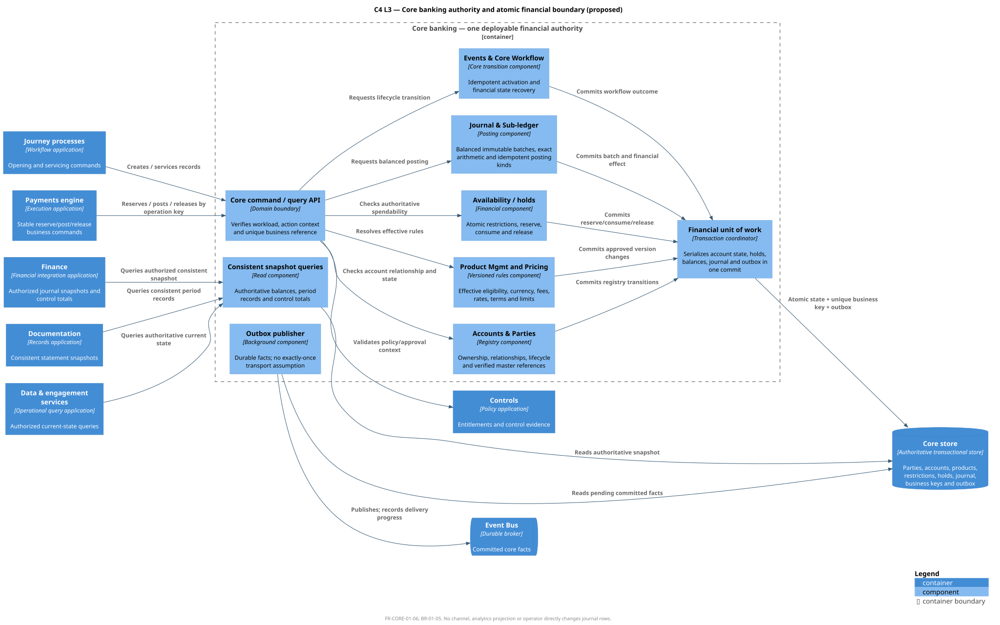

<details>
<summary>Complete PlantUML source</summary>

```plantuml
@startuml
!include <C4/C4_Component>
!include ../theme.puml
LAYOUT_LEFT_RIGHT()
title C4 L3 — Core banking authority and atomic financial boundary (proposed)
Container(journey, "Journey processes", "Workflow application", "Opening and servicing commands")
Container(payments, "Payments engine", "Execution application", "Stable reserve/post/release business commands")
Container(controls, "Controls", "Policy application", "Entitlements and control evidence")
Container(finance, "Finance", "Financial integration application", "Authorized journal snapshots and control totals")
Container(documents, "Documentation", "Records application", "Consistent statement snapshots")
Container(data, "Data & engagement services", "Operational query application", "Authorized current-state queries")
ContainerDb(coreDb, "Core store", "Authoritative transactional store", "Parties, accounts, products, restrictions, holds, journal, business keys and outbox")
ContainerQueue(bus, "Event Bus", "Durable broker", "Committed core facts")
Container_Boundary(core, "Core banking — one deployable financial authority") {
  Component(api, "Core command / query API", "Domain boundary", "Verifies workload, action context and unique business reference")
  Component(parties, "Accounts & Parties", "Registry component", "Ownership, relationships, lifecycle and verified master references")
  Component(products, "Product Mgmt and Pricing", "Versioned rules component", "Effective eligibility, currency, fees, rates, terms and limits")
  Component(holds, "Availability / holds", "Financial component", "Atomic restrictions, reserve, consume and release")
  Component(journal, "Journal & Sub-ledger", "Posting component", "Balanced immutable batches, exact arithmetic and idempotent posting kinds")
  Component(workflow, "Events & Core Workflow", "Core transition component", "Idempotent activation and financial state recovery")
  Component(unit, "Financial unit of work", "Transaction coordinator", "Serializes account state, holds, balances, journal and outbox in one commit")
  Component(snapshot, "Consistent snapshot queries", "Read component", "Authoritative balances, period records and control totals")
  Component(outbox, "Outbox publisher", "Background component", "Durable facts; no exactly-once transport assumption")
}
Rel(journey, api, "Creates / services records")
Rel(payments, api, "Reserves / posts / releases by operation key")
Rel(api, controls, "Validates policy/approval context")
Rel(api, parties, "Checks account relationship and state")
Rel(api, products, "Resolves effective rules")
Rel(api, holds, "Checks authoritative spendability")
Rel(api, journal, "Requests balanced posting")
Rel(api, workflow, "Requests lifecycle transition")
Rel(parties, unit, "Commits registry transitions")
Rel(products, unit, "Commits approved version changes")
Rel(holds, unit, "Commits reserve/consume/release")
Rel(journal, unit, "Commits batch and financial effect")
Rel(workflow, unit, "Commits workflow outcome")
Rel(unit, coreDb, "Atomic state + unique business key + outbox")
Rel(finance, snapshot, "Queries authorized consistent snapshot")
Rel(documents, snapshot, "Queries consistent period records")
Rel(data, snapshot, "Queries authoritative current state")
Rel(snapshot, coreDb, "Reads authoritative snapshot")
Rel(outbox, coreDb, "Reads pending committed facts")
Rel(outbox, bus, "Publishes; records delivery progress")
SHOW_LEGEND()
footer FR-CORE-01–06; BR-01–05. No channel, analytics projection or operator directly changes journal rows.
@enduml
```

</details>

## C4 L3 — Payment components

Approvals, execution, adapters, evidence and recovery; FR-PAY, FR-EXT.

[Editable PlantUML](c4/05-payments-components.puml) · [Open SVG](rendered/05-payments-components.svg)

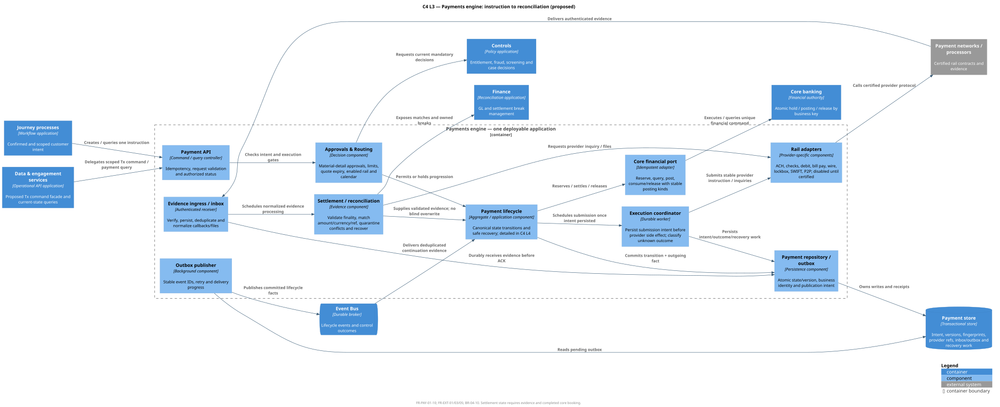

<details>
<summary>Complete PlantUML source</summary>

```plantuml
@startuml
!include <C4/C4_Component>
!include ../theme.puml
LAYOUT_LEFT_RIGHT()
title C4 L3 — Payments engine: instruction to reconciliation (proposed)
Container(journey, "Journey processes", "Workflow application", "Confirmed and scoped customer intent")
Container(data, "Data & engagement services", "Operational API application", "Proposed Tx command facade and current-state queries")
Container(core, "Core banking", "Financial authority", "Atomic hold / posting / release by business key")
Container(controls, "Controls", "Policy application", "Entitlement, fraud, screening and case decisions")
Container(finance, "Finance", "Reconciliation application", "GL and settlement break management")
System_Ext(rails, "Payment networks / processors", "Certified rail contracts and evidence")
ContainerDb(paymentDb, "Payment store", "Transactional store", "Intent, versions, fingerprints, provider refs, inbox/outbox and recovery work")
ContainerQueue(bus, "Event Bus", "Durable broker", "Lifecycle events and control outcomes")
Container_Boundary(payments, "Payments engine — one deployable application") {
  Component(api, "Payment API", "Command / query controller", "Idempotency, request validation and authorized status")
  Component(approval, "Approvals & Routing", "Decision component", "Material-detail approvals, limits, quote expiry, enabled rail and calendar")
  Component(lifecycle, "Payment lifecycle", "Aggregate / application component", "Canonical state transitions and safe recovery; detailed in C4 L4")
  Component(corePort, "Core financial port", "Idempotent adapter", "Reserve, query, post, consume/release with stable posting kinds")
  Component(execution, "Execution coordinator", "Durable worker", "Persist submission intent before provider side effect; classify unknown outcome")
  Component(adapters, "Rail adapters", "Provider-specific components", "ACH, checks, debit, bill pay, wire, lockbox, SWIFT, P2P; disabled until certified")
  Component(callback, "Evidence ingress / inbox", "Authenticated receiver", "Verify, persist, deduplicate and normalize callbacks/files")
  Component(matcher, "Settlement / reconciliation", "Evidence component", "Validate finality, match amount/currency/ref, quarantine conflicts and recover")
  Component(repository, "Payment repository / outbox", "Persistence component", "Atomic state/version, business identity and publication intent")
  Component(publisher, "Outbox publisher", "Background component", "Stable event IDs, retry and delivery progress")
}
Rel(journey, api, "Creates / queries one instruction")
Rel(data, api, "Delegates scoped Tx command / payment query")
Rel(api, approval, "Checks intent and execution gates")
Rel(approval, controls, "Requests current mandatory decisions")
Rel(approval, lifecycle, "Permits or holds progression")
Rel(lifecycle, corePort, "Reserves / settles / releases")
Rel(corePort, core, "Executes / queries unique financial command")
Rel(lifecycle, execution, "Schedules submission once intent persisted")
Rel(execution, adapters, "Submits stable provider instruction / inquiries")
Rel(adapters, rails, "Calls certified provider protocol")
Rel(rails, callback, "Delivers authenticated evidence")
Rel(callback, repository, "Durably receives evidence before ACK")
Rel(callback, matcher, "Schedules normalized evidence processing")
Rel(matcher, adapters, "Requests provider inquiry / files")
Rel(matcher, lifecycle, "Supplies validated evidence; no blind overwrite")
Rel(matcher, finance, "Exposes matches and owned breaks")
Rel(lifecycle, repository, "Commits transition + outgoing fact")
Rel(execution, repository, "Persists intent/outcome/recovery work")
Rel(repository, paymentDb, "Owns writes and receipts")
Rel(publisher, paymentDb, "Reads pending outbox")
Rel(publisher, bus, "Publishes committed lifecycle facts")
Rel(bus, lifecycle, "Delivers deduplicated continuation evidence")
SHOW_LEGEND()
footer FR-PAY-01–10; FR-EXT-01/03/05; BR-04–10. Settlement state requires evidence and completed core booking.
@enduml
```

</details>

## C4 L3 — Control components

Separate entitlements, identity, screening, risk, fraud, cases and audit; FR-CTRL.

[Editable PlantUML](c4/06-controls-components.puml) · [Open SVG](rendered/06-controls-components.svg)

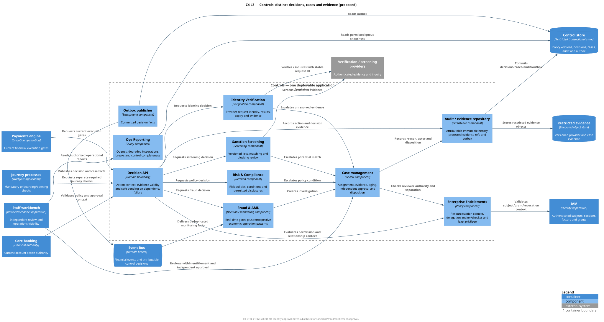

<details>
<summary>Complete PlantUML source</summary>

```plantuml
@startuml
!include <C4/C4_Component>
!include ../theme.puml
LAYOUT_LEFT_RIGHT()
title C4 L3 — Controls: distinct decisions, cases and evidence (proposed)
Container(journey, "Journey processes", "Workflow application", "Mandatory onboarding/opening checks")
Container(core, "Core banking", "Financial authority", "Current account action authority")
Container(payments, "Payments engine", "Execution application", "Current financial execution gates")
Container(iam, "IAM", "Identity application", "Authenticated subjects, sessions, factors and grants")
Container(staff, "Staff workbench", "Restricted channel application", "Independent review and operations visibility")
ContainerDb(controlDb, "Control store", "Restricted transactional store", "Policy versions, decisions, cases, audit and outbox")
ContainerDb(evidenceStore, "Restricted evidence", "Encrypted object store", "Versioned provider and case evidence")
ContainerQueue(bus, "Event Bus", "Durable broker", "Financial events and attributable control decisions")
System_Ext(providers, "Verification / screening providers", "Authenticated evidence and inquiry")
Container_Boundary(controls, "Controls — one deployable application") {
  Component(api, "Decision API", "Domain boundary", "Action context, evidence validity and safe pending on dependency failure")
  Component(entitlement, "Enterprise Entitlements", "Policy component", "Resource/action context, delegation, maker/checker and least privilege")
  Component(identity, "Identity Verification", "Verification component", "Provider request identity, results, expiry and evidence")
  Component(screening, "Sanction Screening", "Screening component", "Versioned lists, matching and blocking review")
  Component(risk, "Risk & Compliance", "Decision component", "Risk policies, conditions and permitted disclosures")
  Component(fraud, "Fraud & AML", "Decision / monitoring component", "Real-time gates plus retrospective economic-operation patterns")
  Component(cases, "Case management", "Review component", "Assignment, evidence, aging, independent approval and disposition")
  Component(reporting, "Ops Reporting", "Query component", "Queues, degraded integrations, breaks and control completeness")
  Component(audit, "Audit / evidence repository", "Persistence component", "Attributable immutable history, protected evidence refs and outbox")
  Component(publisher, "Outbox publisher", "Background component", "Committed decision facts")
}
Rel(journey, api, "Requests separate required journey checks")
Rel(core, api, "Validates policy and approval context")
Rel(payments, api, "Requests current execution gates")
Rel(api, entitlement, "Evaluates permission and relationship context")
Rel(entitlement, iam, "Validates subject/grant/revocation context")
Rel(api, identity, "Requests identity decision")
Rel(api, screening, "Requests screening decision")
Rel(api, risk, "Requests policy decision")
Rel(api, fraud, "Requests fraud decision")
Rel(identity, providers, "Verifies / inquires with stable request ID")
Rel(screening, providers, "Screens / retrieves evidence")
Rel(identity, cases, "Escalates unresolved evidence")
Rel(screening, cases, "Escalates potential match")
Rel(risk, cases, "Escalates policy condition")
Rel(fraud, cases, "Creates investigation")
Rel(staff, cases, "Reviews within entitlement and independent approval")
Rel(staff, reporting, "Reads authorized operational reports")
Rel(cases, entitlement, "Checks reviewer authority and separation")
Rel(api, audit, "Records action and decision evidence")
Rel(cases, audit, "Records reason, actor and disposition")
Rel(audit, controlDb, "Commits decisions/cases/audit/outbox")
Rel(audit, evidenceStore, "Stores restricted evidence objects")
Rel(reporting, controlDb, "Reads permitted queue snapshots")
Rel(bus, fraud, "Delivers deduplicated monitoring facts")
Rel(publisher, controlDb, "Reads outbox")
Rel(publisher, bus, "Publishes decision and case facts")
SHOW_LEGEND()
footer FR-CTRL-01–07; SEC-01–10. Identity approval never substitutes for sanctions/fraud/entitlement approval.
@enduml
```

</details>

## C4 L4 — Payment code design

Proposed UML classes inside the L3 Payment lifecycle component; no existing implementation is implied.

[Editable PlantUML](c4/07-payment-code.puml) · [Open SVG](rendered/07-payment-code.svg)

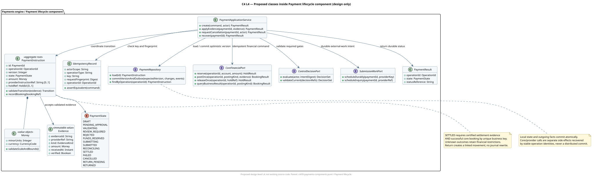

<details>
<summary>Complete PlantUML source</summary>

```plantuml
@startuml
!include ../theme.puml
title C4 L4 — Proposed classes inside Payment lifecycle component (design only)
hide empty members

package "Payments engine / Payment lifecycle component" {
  class PaymentApplicationService {
    +create(command, actor): PaymentResult
    +applyEvidence(paymentId, evidence): PaymentResult
    +requestCancellation(paymentId, actor): PaymentResult
    +recover(paymentId): PaymentResult
  }
  class PaymentInstruction <<aggregate root>> {
    +id: PaymentId
    +operationId: OperationId
    +version: Integer
    +state: PaymentState
    +amount: Money
    +providerInstructionRef: String [0..1]
    +holdRef: HoldId [0..1]
    +validateTransition(evidence): Transition
    +recordBooking(bookingRef)
  }
  class Money <<value object>> {
    +minorUnits: Integer
    +currency: CurrencyCode
    +validateScaleAndBounds()
  }
  class IdempotencyRecord {
    +actorScope: String
    +operationType: String
    +key: String
    +requestFingerprint: Digest
    +operationId: OperationId
    +assertEquivalent(command)
  }
  class Evidence <<immutable value>> {
    +evidenceId: String
    +providerRef: String
    +kind: EvidenceKind
    +amount: Money
    +receivedAt: Instant
    +verified: Boolean
  }
  enum PaymentState {
    DRAFT
    PENDING_APPROVAL
    VALIDATING
    REVIEW_REQUIRED
    REJECTED
    FUNDS_RESERVED
    SUBMITTING
    SUBMITTED
    RECONCILING
    SETTLED
    FAILED
    CANCELLED
    RETURN_PENDING
    RETURNED
  }
  interface PaymentRepository {
    +load(id): PaymentInstruction
    +commitVersionAndOutbox(expectedVersion, changes, events)
    +findByOperation(operationId): PaymentInstruction
  }
  interface CoreFinancialPort {
    +reserve(operationId, account, amount): HoldResult
    +postOnce(operationId, postingKind, evidence): BookingResult
    +releaseOnce(operationId, holdRef): HoldResult
    +queryBusinessResult(operationId, postingKind): BookingResult
  }
  interface ControlDecisionPort {
    +evaluate(actor, intentDigest): DecisionSet
    +validateCurrent(decisionRefs): DecisionSet
  }
  interface SubmissionWorkPort {
    +scheduleDurably(paymentId, providerKey)
    +scheduleInquiry(paymentId, providerRef)
  }
  class PaymentResult {
    +operationId: OperationId
    +state: PaymentState
    +statusReference: String
  }
}
PaymentApplicationService --> PaymentRepository : load / commit optimistic version
PaymentApplicationService --> ControlDecisionPort : validate required gates
PaymentApplicationService --> CoreFinancialPort : idempotent financial command
PaymentApplicationService --> SubmissionWorkPort : durable external-work intent
PaymentApplicationService --> IdempotencyRecord : check key and fingerprint
PaymentApplicationService --> PaymentInstruction : coordinate transition
PaymentApplicationService --> PaymentResult : return durable status
PaymentInstruction *-- Money
PaymentInstruction --> PaymentState
PaymentInstruction --> Evidence : accepts validated evidence
note bottom of PaymentInstruction
  SETTLED requires certified settlement evidence
  AND successful core booking by unique business key.
  Unknown outcomes retain financial restrictions.
  Return creates a linked movement; no journal rewrite.
end note
note bottom of PaymentRepository
  Local state and outgoing facts commit atomically.
  Core/provider calls are separate side effects recovered
  by stable operation identities, never a distributed commit.
end note
footer Proposed design-level L4; not existing source code. Parent: c4/05-payments-components.puml / Payment lifecycle.
@enduml
```

</details>

## C4 dynamic — Payment flow

Numbered successful outgoing payment interactions; failures are detailed in UML sequences.

[Editable PlantUML](c4/08-payment-dynamic.puml) · [Open SVG](rendered/08-payment-dynamic.svg)

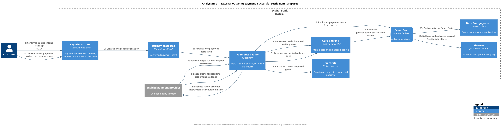

<details>
<summary>Complete PlantUML source</summary>

```plantuml
@startuml
!include <C4/C4_Dynamic>
!include ../theme.puml
LAYOUT_LEFT_RIGHT()
title C4 dynamic — External outgoing payment, successful settlement (proposed)
Person(customer, "Customer")
System_Ext(rail, "Enabled payment provider", "Certified finality contract")
System_Boundary(bank, "Digital Bank") {
  Container(edge, "Experience APIs", "Channel adaptation", "Requests traverse API Gateway; ingress hop omitted in this view")
  Container(journey, "Journey processes", "Durable workflow", "Confirmed payment intent")
  Container(controls, "Controls", "Policy / checks", "Permission, screening, fraud and approval")
  Container(payments, "Payments engine", "Execution", "Persist intent, submit, reconcile and publish")
  Container(core, "Core banking", "Financial authority", "Atomic hold and balanced booking")
  ContainerQueue(bus, "Event Bus", "Durable broker", "At-least-once facts")
  Container(finance, "Finance", "GL / reconciliation", "Balanced idempotent mapping")
  Container(data, "Data & engagement", "Queries / alerts", "Customer status and notification")
}
RelIndex(1, customer, edge, "Confirms quoted intent + step-up", "HTTPS")
RelIndex(2, edge, journey, "Creates one scoped operation")
RelIndex(3, journey, payments, "Persists one payment instruction")
RelIndex(4, payments, controls, "Validates current required gates")
RelIndex(5, payments, core, "Reserves authoritative funds once")
RelIndex(6, payments, rail, "Submits stable provider instruction after durable intent")
RelIndex(7, rail, payments, "Acknowledges submission; not settlement")
RelIndex(8, rail, payments, "Sends authenticated final settlement evidence")
RelIndex(9, payments, core, "Consumes hold + balanced booking once")
RelIndex(10, payments, bus, "Publishes payment.settled from outbox")
RelIndex(11, core, bus, "Publishes journal.batch-posted from outbox")
RelIndex(12, bus, finance, "Delivers deduplicated journal / settlement facts")
RelIndex(13, bus, data, "Delivers status / alert facts")
RelIndex(14, customer, edge, "Queries stable payment ID and actual current status")
SHOW_LEGEND()
footer Ordered narrative, not a distributed transaction. Events 10/11 can arrive in either order. Failures: UML payment/reconciliation views.
@enduml
```

</details>

## C4 deployment — Production and recovery

Provider-neutral instance placement, trust zones, protection and recovery; NFR-06/07.

[Editable PlantUML](c4/09-deployment.puml) · [Open SVG](rendered/09-deployment.svg)

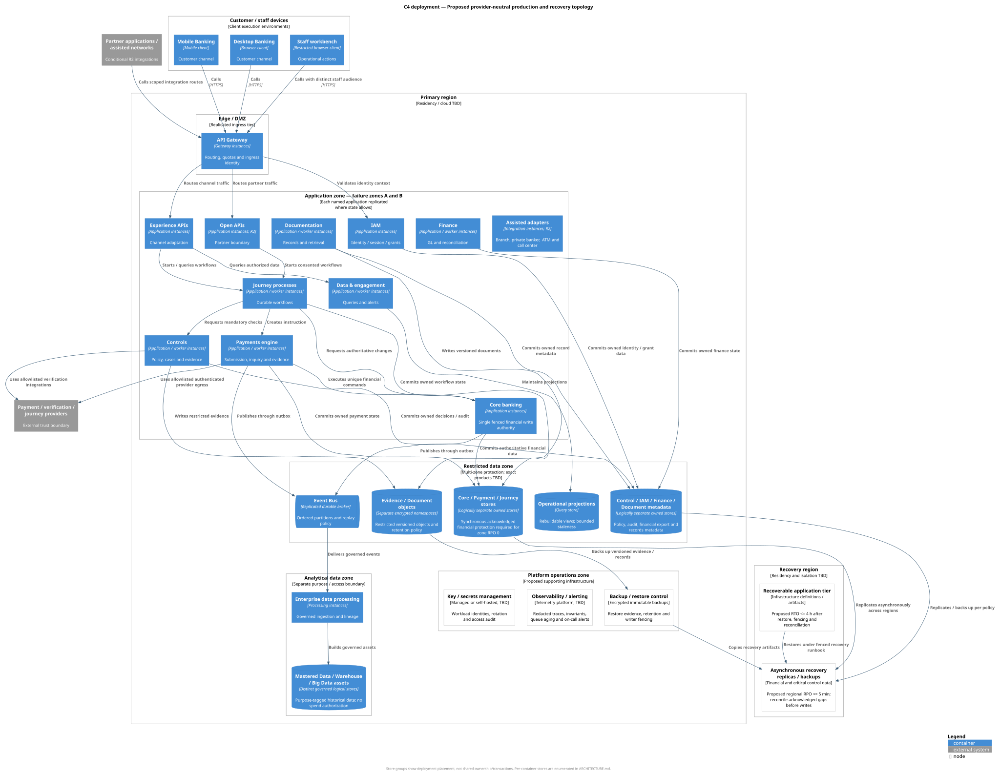

<details>
<summary>Complete PlantUML source</summary>

```plantuml
@startuml
!include <C4/C4_Deployment>
!include ../theme.puml
LAYOUT_TOP_DOWN()
title C4 deployment — Proposed provider-neutral production and recovery topology
Deployment_Node(device, "Customer / staff devices", "Client execution environments") {
  Container(mobile, "Mobile Banking", "Mobile client", "Customer channel")
  Container(web, "Desktop Banking", "Browser client", "Customer channel")
  Container(staff, "Staff workbench", "Restricted browser client", "Operational actions")
}
System_Ext(provider, "Payment / verification / journey providers", "External trust boundary")
System_Ext(partner, "Partner applications / assisted networks", "Conditional R2 integrations")
Deployment_Node(primary, "Primary region", "Residency / cloud TBD") {
  Deployment_Node(edge, "Edge / DMZ", "Replicated ingress tier") {
    Container(gateway, "API Gateway", "Gateway instances", "Routing, quotas and ingress identity")
  }
  Deployment_Node(app, "Application zone — failure zones A and B", "Each named application replicated where state allows") {
    Container(experience, "Experience APIs", "Application instances", "Channel adaptation")
    Container(openapi, "Open APIs", "Application instances; R2", "Partner boundary")
    Container(iam, "IAM", "Application instances", "Identity / session / grants")
    Container(journey, "Journey processes", "Application / worker instances", "Durable workflows")
    Container(core, "Core banking", "Application instances", "Single fenced financial write authority")
    Container(payments, "Payments engine", "Application / worker instances", "Submission, inquiry and evidence")
    Container(controls, "Controls", "Application / worker instances", "Policy, cases and evidence")
    Container(data, "Data & engagement", "Application / worker instances", "Queries and alerts")
    Container(finance, "Finance", "Application / worker instances", "GL and reconciliation")
    Container(documents, "Documentation", "Application / worker instances", "Records and retrieval")
    Container(assisted, "Assisted adapters", "Integration instances; R2", "Branch, private banker, ATM and call center")
  }
  Deployment_Node(restricted, "Restricted data zone", "Multi-zone protection; exact products TBD") {
    ContainerDb(financialStores, "Core / Payment / Journey stores", "Logically separate owned stores", "Synchronous acknowledged financial protection required for zone RPO 0")
    ContainerDb(controlStores, "Control / IAM / Finance / Document metadata", "Logically separate owned stores", "Policy, audit, financial export and records metadata")
    ContainerDb(projectionDb, "Operational projections", "Query store", "Rebuildable views; bounded staleness")
    ContainerDb(objects, "Evidence / Document objects", "Separate encrypted namespaces", "Restricted versioned objects and retention policy")
    ContainerQueue(bus, "Event Bus", "Replicated durable broker", "Ordered partitions and replay policy")
  }
  Deployment_Node(analyticZone, "Analytical data zone", "Separate purpose / access boundary") {
    Container(analytics, "Enterprise data processing", "Processing instances", "Governed ingestion and lineage")
    ContainerDb(assets, "Mastered Data / Warehouse / Big Data assets", "Distinct governed logical stores", "Purpose-tagged historical data; no spend authorization")
  }
  Deployment_Node(ops, "Platform operations zone", "Proposed supporting infrastructure") {
    Deployment_Node(keys, "Key / secrets management", "Managed or self-hosted; TBD", "Workload identities, rotation and access audit")
    Deployment_Node(observability, "Observability / alerting", "Telemetry platform; TBD", "Redacted traces, invariants, queue aging and on-call alerts")
    Deployment_Node(backups, "Backup / restore control", "Encrypted immutable backups", "Restore evidence, retention and writer fencing")
  }
}
Deployment_Node(recovery, "Recovery region", "Residency and isolation TBD") {
  Deployment_Node(replica, "Asynchronous recovery replicas / backups", "Financial and critical control data", "Proposed regional RPO <= 5 min; reconcile acknowledged gaps before writes")
  Deployment_Node(recoveryApps, "Recoverable application tier", "Infrastructure definitions / artifacts", "Proposed RTO <= 4 h after restore, fencing and reconciliation")
}
Rel(mobile, gateway, "Calls", "HTTPS")
Rel(web, gateway, "Calls", "HTTPS")
Rel(staff, gateway, "Calls with distinct staff audience", "HTTPS")
Rel(partner, gateway, "Calls scoped integration routes")
Rel(gateway, experience, "Routes channel traffic")
Rel(gateway, openapi, "Routes partner traffic")
Rel(gateway, iam, "Validates identity context")
Rel(experience, journey, "Starts / queries workflows")
Rel(experience, data, "Queries authorized data")
Rel(openapi, journey, "Starts consented workflows")
Rel(journey, core, "Requests authoritative changes")
Rel(journey, controls, "Requests mandatory checks")
Rel(journey, payments, "Creates instruction")
Rel(payments, core, "Executes unique financial commands")
Rel(payments, provider, "Uses allowlisted authenticated provider egress")
Rel(controls, provider, "Uses allowlisted verification integrations")
Rel(core, financialStores, "Commits authoritative financial data")
Rel(payments, financialStores, "Commits owned payment state")
Rel(journey, financialStores, "Commits owned workflow state")
Rel(controls, controlStores, "Commits owned decisions / audit")
Rel(iam, controlStores, "Commits owned identity / grant data")
Rel(finance, controlStores, "Commits owned finance state")
Rel(documents, controlStores, "Commits owned record metadata")
Rel(documents, objects, "Writes versioned documents")
Rel(controls, objects, "Writes restricted evidence")
Rel(data, projectionDb, "Maintains projections")
Rel(core, bus, "Publishes through outbox")
Rel(payments, bus, "Publishes through outbox")
Rel(bus, analytics, "Delivers governed events")
Rel(analytics, assets, "Builds governed assets")
Rel(financialStores, replica, "Replicates asynchronously across regions")
Rel(controlStores, replica, "Replicates / backs up per policy")
Rel(objects, backups, "Backs up versioned evidence / records")
Rel(backups, replica, "Copies recovery artifacts")
Rel(recoveryApps, replica, "Restores under fenced recovery runbook")
SHOW_LEGEND()
footer Store groups show deployment placement, not shared ownership/transactions. Per-container stores are enumerated in ARCHITECTURE.md.
@enduml
```

</details>

## UML — Use cases

Actors, primary jobs, required controls and optional manual review; full target.

[Editable PlantUML](uml/01-use-cases.puml) · [Open SVG](rendered/01-use-cases.svg)

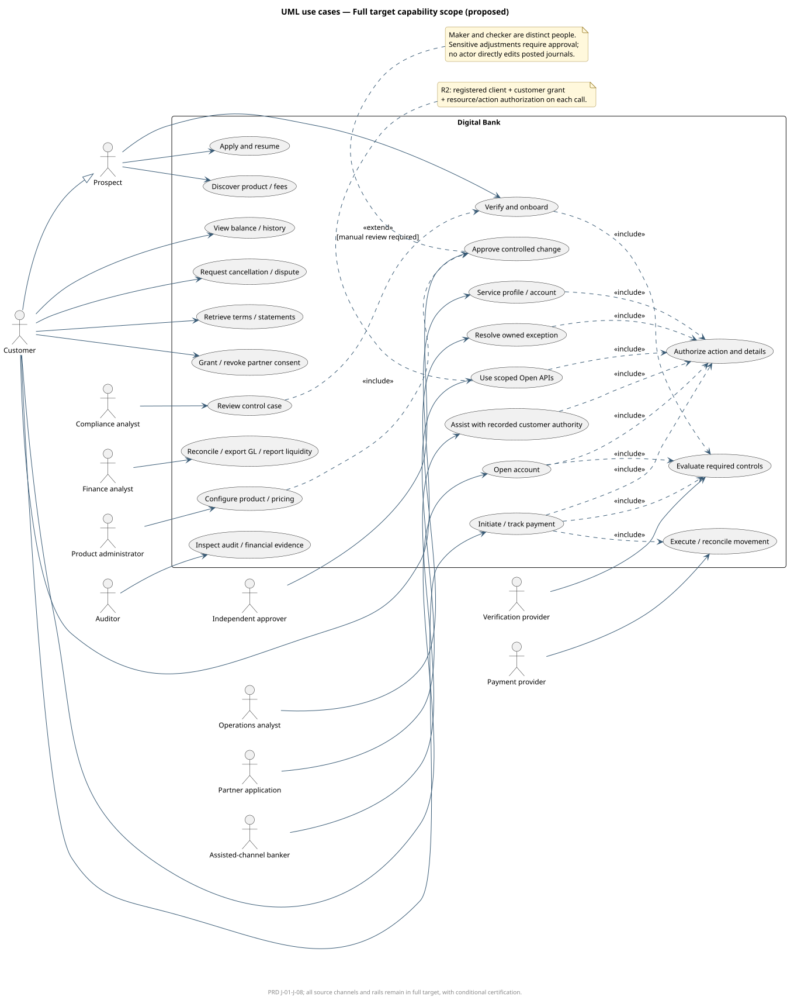

<details>
<summary>Complete PlantUML source</summary>

```plantuml
@startuml
!include ../theme.puml
left to right direction
title UML use cases — Full target capability scope (proposed)
actor Prospect
actor Customer
actor "Assisted-channel banker" as Banker
actor "Operations analyst" as Operator
actor "Compliance analyst" as Compliance
actor "Independent approver" as Approver
actor "Finance analyst" as Finance
actor "Product administrator" as ProductAdmin
actor Auditor
actor "Partner application" as Partner
actor "Payment provider" as Rail
actor "Verification provider" as Verification
Customer --|> Prospect
rectangle "Digital Bank" {
  usecase "Discover product / fees" as Discover
  usecase "Apply and resume" as Apply
  usecase "Verify and onboard" as Onboard
  usecase "Review control case" as Review
  usecase "Open account" as Open
  usecase "View balance / history" as Inquiry
  usecase "Service profile / account" as Service
  usecase "Initiate / track payment" as Pay
  usecase "Authorize action and details" as Authorize
  usecase "Evaluate required controls" as Check
  usecase "Execute / reconcile movement" as Execute
  usecase "Request cancellation / dispute" as Dispute
  usecase "Retrieve terms / statements" as Docs
  usecase "Grant / revoke partner consent" as Consent
  usecase "Use scoped Open APIs" as OpenAPI
  usecase "Assist with recorded customer authority" as Assist
  usecase "Resolve owned exception" as Exception
  usecase "Approve controlled change" as Approve
  usecase "Reconcile / export GL / report liquidity" as Reconcile
  usecase "Configure product / pricing" as Configure
  usecase "Inspect audit / financial evidence" as Audit
}
Prospect --> Discover
Prospect --> Apply
Prospect --> Onboard
Customer --> Open
Customer --> Inquiry
Customer --> Service
Customer --> Pay
Customer --> Dispute
Customer --> Docs
Customer --> Consent
Banker --> Assist
Partner --> OpenAPI
Operator --> Exception
Compliance --> Review
Approver --> Approve
Finance --> Reconcile
ProductAdmin --> Configure
Auditor --> Audit
Rail --> Execute
Verification --> Check
Onboard ..> Check : <<include>>
Review ..> Onboard : <<extend>>\n[manual review required]
Open ..> Authorize : <<include>>
Open ..> Check : <<include>>
Pay ..> Authorize : <<include>>
Pay ..> Check : <<include>>
Pay ..> Execute : <<include>>
Service ..> Authorize : <<include>>
Assist ..> Authorize : <<include>>
OpenAPI ..> Authorize : <<include>>
Exception ..> Authorize : <<include>>
Configure ..> Approve : <<include>>
note bottom of Approve
  Maker and checker are distinct people.
  Sensitive adjustments require approval;
  no actor directly edits posted journals.
end note
note bottom of OpenAPI
  R2: registered client + customer grant
  + resource/action authorization on each call.
end note
footer PRD J-01–J-08; all source channels and rails remain in full target, with conditional certification.
@enduml
```

</details>

## UML — Domain model

Business entities, multiplicities, financial invariants and owning domains; PRD section 9.

[Editable PlantUML](uml/02-domain-model.puml) · [Open SVG](rendered/02-domain-model.svg)

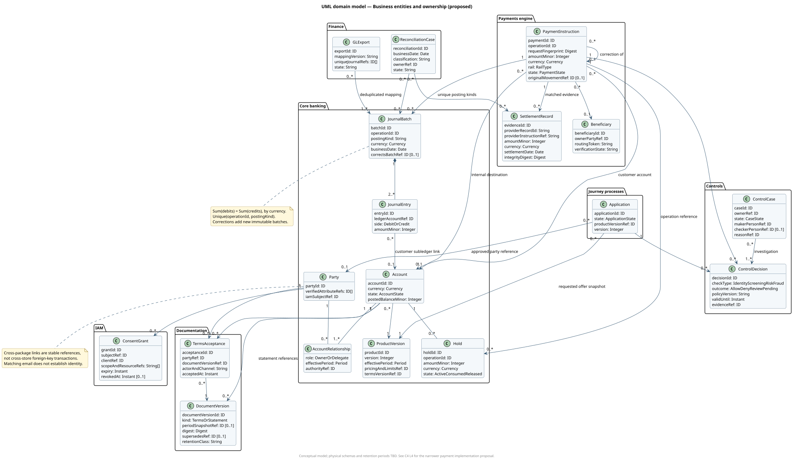

<details>
<summary>Complete PlantUML source</summary>

```plantuml
@startuml
!include ../theme.puml
hide empty methods
title UML domain model — Business entities and ownership (proposed)

package "Journey processes" {
  class Application {
    applicationId: ID
    state: ApplicationState
    productVersionRef: ID
    version: Integer
  }
}
package "Core banking" {
  class Party {
    partyId: ID
    verifiedAttributeRefs: ID[]
    iamSubjectRef: ID
  }
  class AccountRelationship {
    role: OwnerOrDelegate
    effectivePeriod: Period
    authorityRef: ID
  }
  class Account {
    accountId: ID
    currency: Currency
    state: AccountState
    postedBalanceMinor: Integer
  }
  class ProductVersion {
    productId: ID
    version: Integer
    effectivePeriod: Period
    pricingAndLimitsRef: ID
    termsVersionRef: ID
  }
  class Hold {
    holdId: ID
    operationId: ID
    amountMinor: Integer
    currency: Currency
    state: ActiveConsumedReleased
  }
  class JournalBatch {
    batchId: ID
    operationId: ID
    postingKind: String
    currency: Currency
    businessDate: Date
    correctsBatchRef: ID [0..1]
  }
  class JournalEntry {
    entryId: ID
    ledgerAccountRef: ID
    side: DebitOrCredit
    amountMinor: Integer
  }
}
package "Payments engine" {
  class PaymentInstruction {
    paymentId: ID
    operationId: ID
    requestFingerprint: Digest
    amountMinor: Integer
    currency: Currency
    rail: RailType
    state: PaymentState
    originalMovementRef: ID [0..1]
  }
  class Beneficiary {
    beneficiaryId: ID
    ownerPartyRef: ID
    routingToken: String
    verificationState: String
  }
  class SettlementRecord {
    evidenceId: ID
    providerRecordId: String
    providerInstructionRef: String
    amountMinor: Integer
    currency: Currency
    settlementDate: Date
    integrityDigest: Digest
  }
}
package "Controls" {
  class ControlDecision {
    decisionId: ID
    checkType: IdentityScreeningRiskFraud
    outcome: AllowDenyReviewPending
    policyVersion: String
    validUntil: Instant
    evidenceRef: ID
  }
  class ControlCase {
    caseId: ID
    ownerRef: ID
    state: CaseState
    makerPersonRef: ID
    checkerPersonRef: ID [0..1]
    reasonRef: ID
  }
}
package "IAM" {
  class ConsentGrant {
    grantId: ID
    subjectRef: ID
    clientRef: ID
    scopeAndResourceRefs: String[]
    expiry: Instant
    revokedAt: Instant [0..1]
  }
}
package "Documentation" {
  class TermsAcceptance {
    acceptanceId: ID
    partyRef: ID
    documentVersionRef: ID
    actorAndChannel: String
    acceptedAt: Instant
  }
  class DocumentVersion {
    documentVersionId: ID
    kind: TermsOrStatement
    periodSnapshotRef: ID [0..1]
    digest: Digest
    supersedesRef: ID [0..1]
    retentionClass: String
  }
}
package "Finance" {
  class ReconciliationCase {
    reconciliationId: ID
    businessDate: Date
    classification: String
    ownerRef: ID
    state: String
  }
  class GLExport {
    exportId: ID
    mappingVersion: String
    uniqueJournalRefs: ID[]
    state: String
  }
}
Application "0..*" --> "0..1" Party : approved party reference
Application "0..*" --> "1" ProductVersion : requested offer snapshot
Party "1" -- "0..*" AccountRelationship
Account "1" -- "1..*" AccountRelationship
Account "0..*" --> "1" ProductVersion
Account "1" -- "0..*" Hold
JournalBatch "1" *-- "2..*" JournalEntry
JournalEntry "0..*" --> "0..1" Account : customer subledger link
PaymentInstruction "0..*" --> "1" Account : customer account
PaymentInstruction "0..*" --> "0..1" Account : internal destination
PaymentInstruction "0..*" --> "0..1" Beneficiary
PaymentInstruction "1" --> "0..*" Hold : operation reference
PaymentInstruction "1" --> "0..*" JournalBatch : unique posting kinds
PaymentInstruction "1" --> "0..*" SettlementRecord : matched evidence
PaymentInstruction "0..*" --> "0..1" PaymentInstruction : correction of
Application "1" --> "0..*" ControlDecision
PaymentInstruction "1" --> "0..*" ControlDecision
ControlCase "0..*" --> "1..*" ControlDecision : investigation
Party "1" --> "0..*" ConsentGrant
Party "1" --> "0..*" TermsAcceptance
Account "1" --> "0..*" TermsAcceptance
TermsAcceptance "0..*" --> "1" DocumentVersion
Account "1" --> "0..*" DocumentVersion : statement references
ReconciliationCase "0..*" --> "0..*" SettlementRecord
ReconciliationCase "0..*" --> "0..*" JournalBatch
GLExport "0..*" --> "1..*" JournalBatch : deduplicated mapping
note bottom of JournalBatch
  Sum(debits) = Sum(credits), by currency.
  Unique(operationId, postingKind).
  Corrections add new immutable batches.
end note
note bottom of Party
  Cross-package links are stable references,
  not cross-store foreign-key transactions.
  Matching email does not establish identity.
end note
footer Conceptual model; physical schemas and retention periods TBD. See C4 L4 for the narrower payment implementation proposal.
@enduml
```

</details>

## UML — Onboarding sequence

Pending checks, duplicate evidence, manual review and stable party creation; J-02.

[Editable PlantUML](uml/03-onboarding-sequence.puml) · [Open SVG](rendered/03-onboarding-sequence.svg)

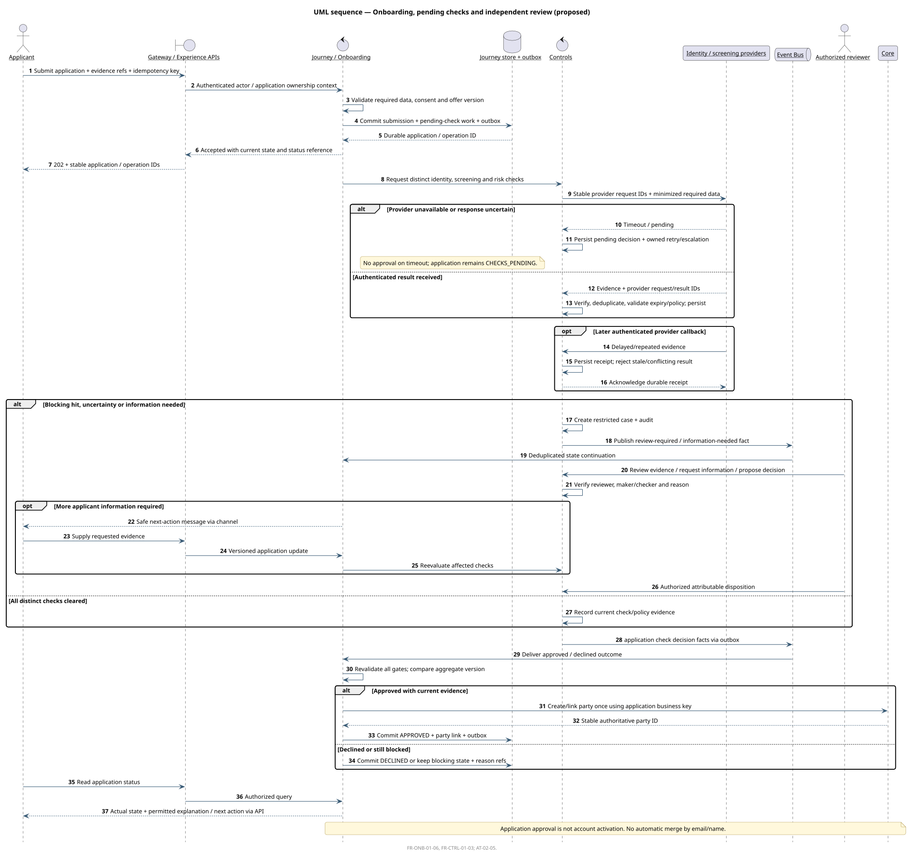

<details>
<summary>Complete PlantUML source</summary>

```plantuml
@startuml
!include ../theme.puml
autonumber
title UML sequence — Onboarding, pending checks and independent review (proposed)
actor Applicant
boundary "Gateway / Experience APIs" as API
control "Journey / Onboarding" as Journey
database "Journey store + outbox" as DB
control Controls
participant "Identity / screening providers" as Provider
queue "Event Bus" as Bus
actor "Authorized reviewer" as Reviewer
participant Core

Applicant -> API : Submit application + evidence refs + idempotency key
API -> Journey : Authenticated actor / application ownership context
Journey -> Journey : Validate required data, consent and offer version
Journey -> DB : Commit submission + pending-check work + outbox
DB --> Journey : Durable application / operation ID
Journey --> API : Accepted with current state and status reference
API --> Applicant : 202 + stable application / operation IDs
Journey -> Controls : Request distinct identity, screening and risk checks
Controls -> Provider : Stable provider request IDs + minimized required data
alt Provider unavailable or response uncertain
  Provider --> Controls : Timeout / pending
  Controls -> Controls : Persist pending decision + owned retry/escalation
  note over Controls, Journey : No approval on timeout; application remains CHECKS_PENDING.
else Authenticated result received
  Provider --> Controls : Evidence + provider request/result IDs
  Controls -> Controls : Verify, deduplicate, validate expiry/policy; persist
end
opt Later authenticated provider callback
  Provider -> Controls : Delayed/repeated evidence
  Controls -> Controls : Persist receipt; reject stale/conflicting result
  Controls --> Provider : Acknowledge durable receipt
end
alt Blocking hit, uncertainty or information needed
  Controls -> Controls : Create restricted case + audit
  Controls -> Bus : Publish review-required / information-needed fact
  Bus -> Journey : Deduplicated state continuation
  Reviewer -> Controls : Review evidence / request information / propose decision
  Controls -> Controls : Verify reviewer, maker/checker and reason
  opt More applicant information required
    Journey --> Applicant : Safe next-action message via channel
    Applicant -> API : Supply requested evidence
    API -> Journey : Versioned application update
    Journey -> Controls : Reevaluate affected checks
  end
  Reviewer -> Controls : Authorized attributable disposition
else All distinct checks cleared
  Controls -> Controls : Record current check/policy evidence
end
Controls -> Bus : application check decision facts via outbox
Bus -> Journey : Deliver approved / declined outcome
Journey -> Journey : Revalidate all gates; compare aggregate version
alt Approved with current evidence
  Journey -> Core : Create/link party once using application business key
  Core --> Journey : Stable authoritative party ID
  Journey -> DB : Commit APPROVED + party link + outbox
else Declined or still blocked
  Journey -> DB : Commit DECLINED or keep blocking state + reason refs
end
Applicant -> API : Read application status
API -> Journey : Authorized query
Journey --> Applicant : Actual state + permitted explanation / next action via API
note over Journey, Core : Application approval is not account activation. No automatic merge by email/name.
footer FR-ONB-01–06, FR-CTRL-01–03; AT-02–05.
@enduml
```

</details>

## UML — Account opening activity

Terms/eligibility gates, idempotency, restricted partial creation and activation; J-03.

[Editable PlantUML](uml/04-account-opening-activity.puml) · [Open SVG](rendered/04-account-opening-activity.svg)

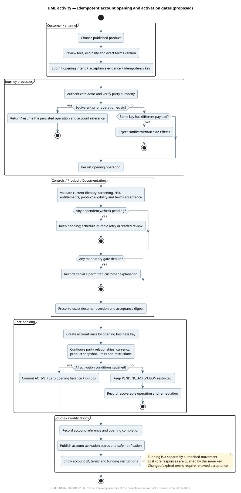

<details>
<summary>Complete PlantUML source</summary>

```plantuml
@startuml
!include ../theme.puml
title UML activity — Idempotent account opening and activation gates (proposed)
start
partition "Customer / channel" {
  :Choose published product;
  :Review fees, eligibility and exact terms version;
  :Submit opening intent + acceptance evidence + idempotency key;
}
partition "Journey processes" {
  :Authenticate actor and verify party authority;
  if (Equivalent prior operation exists?) then (yes)
    :Return/resume the persisted operation and account reference;
    stop
  else (no)
    if (Same key has different payload?) then (yes)
      :Reject conflict without side effects;
      stop
    endif
  endif
  :Persist opening operation;
}
partition "Controls / Product / Documentation" {
  :Validate current identity, screening, risk,
  entitlements, product eligibility and terms acceptance;
  if (Any dependency/check pending?) then (yes)
    :Keep pending; schedule durable retry or staffed review;
    stop
  endif
  if (Any mandatory gate denied?) then (yes)
    :Record denial + permitted customer explanation;
    stop
  endif
  :Preserve exact document version and acceptance digest;
}
partition "Core banking" {
  :Create account once by opening business key;
  :Configure party relationships, currency,
  product snapshot, limits and restrictions;
  if (All activation conditions satisfied?) then (yes)
    :Commit ACTIVE + zero opening balance + outbox;
  else (no)
    :Keep PENDING_ACTIVATION restricted;
    :Record recoverable operation and remediation;
    stop
  endif
}
partition "Journey / notifications" {
  :Record account reference and opening completion;
  :Publish account activation status and safe notification;
  :Show account ID, terms and funding instructions;
}
note right
  Funding is a separately authorized movement.
  Lost core responses are queried by the same key.
  Changed/expired terms require renewed acceptance.
end note
stop
footer FR-ACC-01/02; FR-DOC-01; BR-11/12. Recovery resumes at the durable operation, not a second account creation.
@enduml
```

</details>

## UML — Payment sequence

Durable acceptance, approvals, reservation, timeout, settlement and booking recovery; J-05.

[Editable PlantUML](uml/05-payment-sequence.puml) · [Open SVG](rendered/05-payment-sequence.svg)

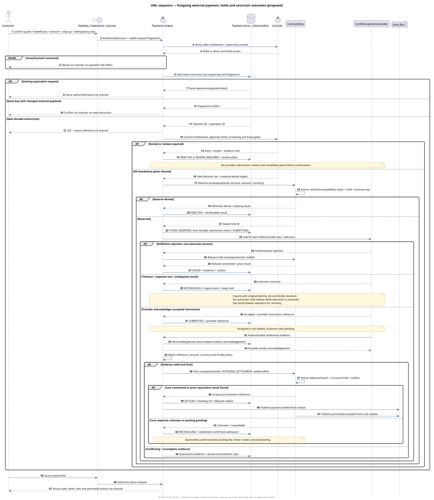

<details>
<summary>Complete PlantUML source</summary>

```plantuml
@startuml
!include ../theme.puml
autonumber
title UML sequence — Outgoing external payment, holds and uncertain outcomes (proposed)
actor Customer
boundary "Gateway / Experience / Journey" as API
control "Payments engine" as Payments
database "Payment store + inbox/outbox" as DB
control Controls
participant "Core banking" as Core
participant "Certified payment provider" as Provider
queue "Event Bus" as Bus

Customer -> API : Confirm quote + beneficiary + amount + step-up + idempotency key
API -> Payments : Authenticated actor + stable request fingerprint
Payments -> Controls : Verify caller entitlement / ownership context
Controls --> Payments : Allow or deny command access
break Unauthorized command
  Payments --> Customer : Denial via channel; no payment side effect
end
Payments -> DB : Get/create instruction by scoped key and fingerprint
alt Existing equivalent request
  DB --> Payments : Same operation/payment/result
  Payments --> Customer : Same authorized status via channel
else Same key with changed material payload
  DB --> Payments : Fingerprint conflict
  Payments --> Customer : Conflict via channel; no new instruction
else New durable instruction
  DB --> Payments : Payment ID + operation ID
  Payments --> Customer : 202 + status reference via channel
  Payments -> Controls : Current entitlement, approval, limits, screening and fraud gates
  alt Denied or review-required
    Controls --> Payments : Deny / review + evidence refs
    Payments -> DB : REJECTED or REVIEW_REQUIRED + audit/outbox
    note over Payments, Provider : No provider submission; review must revalidate gates before continuation.
  else All mandatory gates cleared
    Controls --> Payments : Valid decision set + material-details digest
    Payments -> Core : Reserve once(operationId, account, amount, currency)
    Core -> Core : Atomic restriction/availability check + hold + business key
    alt Reserve denied
      Core --> Payments : Definitive denial / existing result
      Payments -> DB : REJECTED + attributable result
    else Reserved
      Core --> Payments : Stable hold ID
      Payments -> DB : FUNDS_RESERVED; then durable submission intent / SUBMITTING
      Payments -> Provider : Submit with stable provider key / reference
      alt Definitive rejection; non-execution proven
        Provider --> Payments : Authenticated rejection
        Payments -> Core : Release hold once(operationId, holdId)
        Core --> Payments : Release committed / prior result
        Payments -> DB : FAILED + evidence + outbox
      else Timeout / response lost / ambiguous result
        Provider --> Payments : Unknown outcome
        Payments -> DB : RECONCILING + inquiry work + keep hold
        note over Payments, Provider
          Inquire with original identity; do not blindly resubmit.
          No automatic hold release while execution is uncertain.
          See reconciliation sequence for recovery.
        end note
      else Provider acknowledges accepted instruction
        Provider --> Payments : Accepted + provider instruction reference
        Payments -> DB : SUBMITTED + provider reference
        note over Payments, Provider : Accepted is not settled; customer sees pending.
        Provider -> Payments : Authenticated settlement evidence
        Payments -> DB : Persist/deduplicate inbox evidence before acknowledgement
        Payments --> Provider : Durable-receipt acknowledgement
        Payments -> Payments : Match reference, amount, currency and finality policy
        alt Evidence valid and final
          Payments -> Core : Post once(operationId, OUTGOING_SETTLEMENT, evidenceRef)
          Core -> Core : Atomic balanced batch + consume hold + outbox
          alt Core committed or prior equivalent result found
            Core --> Payments : Unique journal batch reference
            Payments -> DB : SETTLED + booking ref + lifecycle outbox
            Payments -> Bus : Publish payment.settled from outbox
            Core -> Bus : Publish journal.batch-posted from core outbox
          else Core response unknown or posting pending
            Core --> Payments : Unknown / unavailable
            Payments -> DB : RECONCILING + settlement-confirmed subreason
            note over Payments, Core : Query/retry same business posting key; never create a second posting.
          end
        else Conflicting / incomplete evidence
          Payments -> DB : Quarantine evidence + owned reconciliation case
        end
      end
    end
  end
end
Customer -> API : Query paymentId
API -> Payments : Authorize status request
Payments --> Customer : Actual state, dates, fees and permitted actions via channel
footer FR-PAY-01–09; AT-06–11. Internal transfers instead post both customer accounts atomically with no external provider.
@enduml
```

</details>

## UML — Reconciliation sequence

Unknown outcomes, evidence matching, correction, GL uniqueness and break ownership; J-06/07.

[Editable PlantUML](uml/06-reconciliation-sequence.puml) · [Open SVG](rendered/06-reconciliation-sequence.svg)

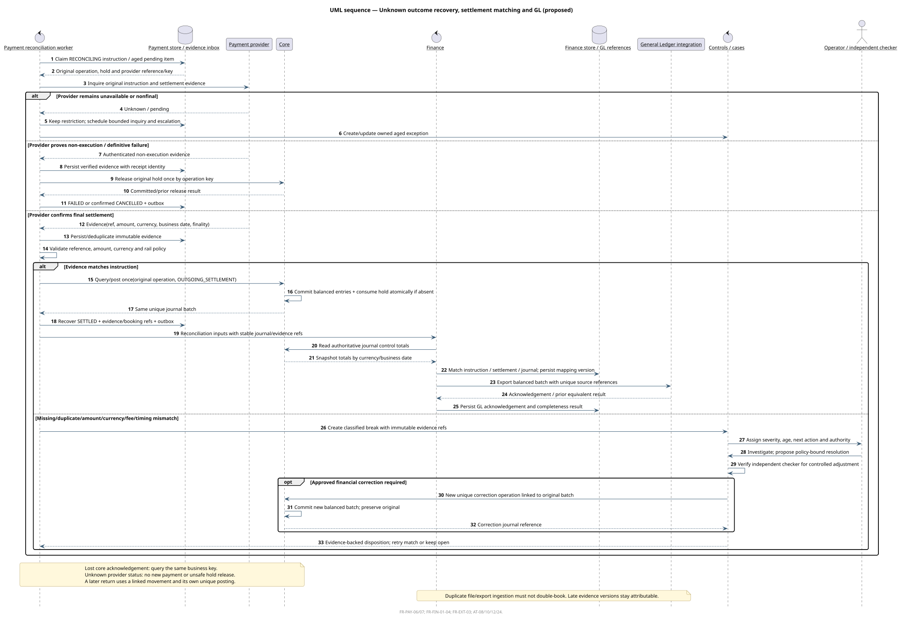

<details>
<summary>Complete PlantUML source</summary>

```plantuml
@startuml
!include ../theme.puml
autonumber
title UML sequence — Unknown outcome recovery, settlement matching and GL (proposed)
control "Payment reconciliation worker" as Worker
database "Payment store / evidence inbox" as DB
participant "Payment provider" as Provider
participant Core
control Finance
database "Finance store / GL references" as FDB
participant "General Ledger integration" as GL
control "Controls / cases" as Cases
actor "Operator / independent checker" as Operator

Worker -> DB : Claim RECONCILING instruction / aged pending item
DB --> Worker : Original operation, hold and provider reference/key
Worker -> Provider : Inquire original instruction and settlement evidence
alt Provider remains unavailable or nonfinal
  Provider --> Worker : Unknown / pending
  Worker -> DB : Keep restriction; schedule bounded inquiry and escalation
  Worker -> Cases : Create/update owned aged exception
else Provider proves non-execution / definitive failure
  Provider --> Worker : Authenticated non-execution evidence
  Worker -> DB : Persist verified evidence with receipt identity
  Worker -> Core : Release original hold once by operation key
  Core --> Worker : Committed/prior release result
  Worker -> DB : FAILED or confirmed CANCELLED + outbox
else Provider confirms final settlement
  Provider --> Worker : Evidence(ref, amount, currency, business date, finality)
  Worker -> DB : Persist/deduplicate immutable evidence
  Worker -> Worker : Validate reference, amount, currency and rail policy
  alt Evidence matches instruction
    Worker -> Core : Query/post once(original operation, OUTGOING_SETTLEMENT)
    Core -> Core : Commit balanced entries + consume hold atomically if absent
    Core --> Worker : Same unique journal batch
    Worker -> DB : Recover SETTLED + evidence/booking refs + outbox
    Worker -> Finance : Reconciliation inputs with stable journal/evidence refs
    Finance -> Core : Read authoritative journal control totals
    Core --> Finance : Snapshot totals by currency/business date
    Finance -> FDB : Match instruction / settlement / journal; persist mapping version
    Finance -> GL : Export balanced batch with unique source references
    GL --> Finance : Acknowledgement / prior equivalent result
    Finance -> FDB : Persist GL acknowledgement and completeness result
  else Missing/duplicate/amount/currency/fee/timing mismatch
    Worker -> Cases : Create classified break with immutable evidence refs
    Cases -> Operator : Assign severity, age, next action and authority
    Operator -> Cases : Investigate; propose policy-bound resolution
    Cases -> Cases : Verify independent checker for controlled adjustment
    opt Approved financial correction required
      Cases -> Core : New unique correction operation linked to original batch
      Core -> Core : Commit new balanced batch; preserve original
      Core --> Cases : Correction journal reference
    end
    Cases --> Worker : Evidence-backed disposition; retry match or keep open
  end
end
note over Worker, Core
  Lost core acknowledgement: query the same business key.
  Unknown provider status: no new payment or unsafe hold release.
  A later return uses a linked movement and its own unique posting.
end note
note over Finance, GL : Duplicate file/export ingestion must not double-book. Late evidence versions stay attributable.
footer FR-PAY-06/07; FR-FIN-01–04; FR-EXT-03; AT-08/10/12/24.
@enduml
```

</details>

## UML — Payment state machine

Canonical outgoing states, safe cancellation and linked returns; BR-04–10.

[Editable PlantUML](uml/07-payment-state.puml) · [Open SVG](rendered/07-payment-state.svg)

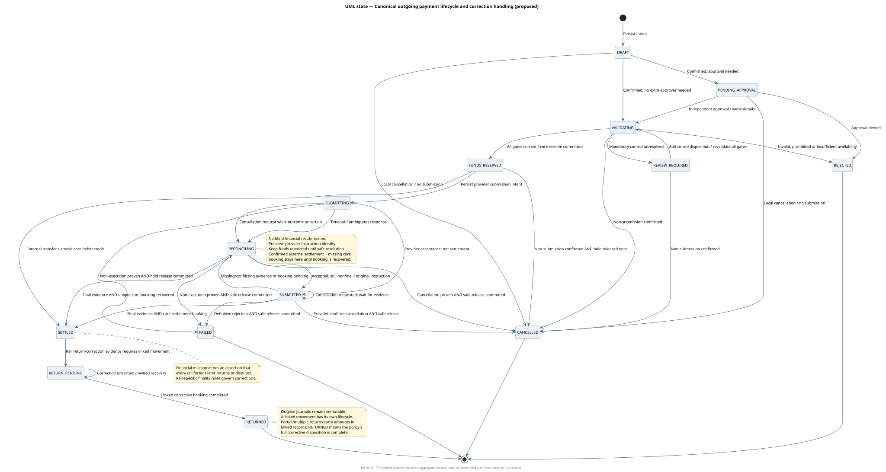

<details>
<summary>Complete PlantUML source</summary>

```plantuml
@startuml
!include ../theme.puml
title UML state — Canonical outgoing payment lifecycle and correction handling (proposed)
hide empty description
[*] --> DRAFT : Persist intent
DRAFT --> PENDING_APPROVAL : Confirmed; approval needed
DRAFT --> VALIDATING : Confirmed; no extra approver needed
PENDING_APPROVAL --> VALIDATING : Independent approval / same details
PENDING_APPROVAL --> REJECTED : Approval denied
VALIDATING --> REVIEW_REQUIRED : Mandatory control unresolved
REVIEW_REQUIRED --> VALIDATING : Authorized disposition / revalidate all gates
VALIDATING --> REJECTED : Invalid, prohibited or insufficient availability
VALIDATING --> FUNDS_RESERVED : All gates current / core reserve committed
FUNDS_RESERVED --> SUBMITTING : Persist provider submission intent
FUNDS_RESERVED --> SETTLED : Internal transfer / atomic core debit+credit
SUBMITTING --> SUBMITTED : Provider acceptance; not settlement
SUBMITTING --> RECONCILING : Timeout / ambiguous response
SUBMITTING --> FAILED : Non-execution proven AND hold release committed
SUBMITTED --> RECONCILING : Missing/conflicting evidence or booking pending
SUBMITTED --> SETTLED : Final evidence AND core settlement booking
SUBMITTED --> FAILED : Definitive rejection AND safe release committed
RECONCILING --> SUBMITTED : Accepted, still nonfinal / original instruction
RECONCILING --> SETTLED : Final evidence AND unique core booking recovered
RECONCILING --> FAILED : Non-execution proven AND safe release committed
RECONCILING --> CANCELLED : Cancellation proven AND safe release committed
DRAFT --> CANCELLED : Local cancellation / no submission
PENDING_APPROVAL --> CANCELLED : Local cancellation / no submission
VALIDATING --> CANCELLED : Non-submission confirmed
REVIEW_REQUIRED --> CANCELLED : Non-submission confirmed
FUNDS_RESERVED --> CANCELLED : Non-submission confirmed AND hold released once
SUBMITTED --> SUBMITTED : Cancellation requested; wait for evidence
SUBMITTED --> CANCELLED : Provider confirms cancellation AND safe release
SUBMITTING --> RECONCILING : Cancellation request while outcome uncertain
SETTLED --> RETURN_PENDING : Rail return/correction evidence requires linked movement
RETURN_PENDING --> RETURNED : Linked corrective booking completed
RETURN_PENDING --> RETURN_PENDING : Correction uncertain / owned recovery
REJECTED --> [*]
FAILED --> [*]
CANCELLED --> [*]
RETURNED --> [*]
note right of RECONCILING
  No blind financial resubmission.
  Preserve provider instruction identity.
  Keep funds restricted until safe resolution.
  Confirmed external settlement + missing core
  booking stays here until booking is recovered.
end note
note right of RETURNED
  Original journals remain immutable.
  A linked movement has its own lifecycle.
  Partial/multiple returns carry amounts in
  linked records; RETURNED means the policy's
  full corrective disposition is complete.
end note
note bottom of SETTLED
  Financial milestone; not an assertion that
  every rail forbids later returns or disputes.
  Rail-specific finality rules govern corrections.
end note
footer BR-04–10. Transitions require expected aggregate version, valid evidence and auditable actor/policy context.
@enduml
```

</details>

## UML — Application state machine

Draft, checks, information, review, approval, decline and expiry; J-01/02.

[Editable PlantUML](uml/08-application-state.puml) · [Open SVG](rendered/08-application-state.svg)

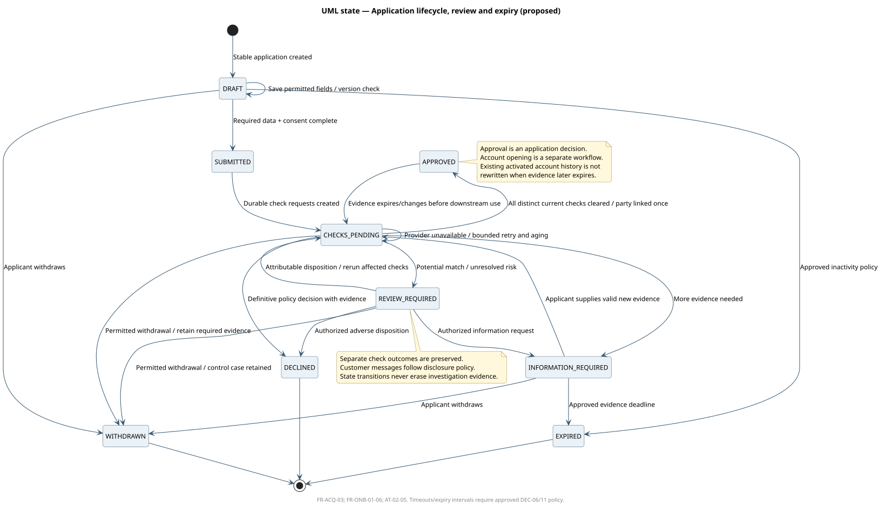

<details>
<summary>Complete PlantUML source</summary>

```plantuml
@startuml
!include ../theme.puml
title UML state — Application lifecycle, review and expiry (proposed)
hide empty description
[*] --> DRAFT : Stable application created
DRAFT --> DRAFT : Save permitted fields / version check
DRAFT --> SUBMITTED : Required data + consent complete
SUBMITTED --> CHECKS_PENDING : Durable check requests created
CHECKS_PENDING --> CHECKS_PENDING : Provider unavailable / bounded retry and aging
CHECKS_PENDING --> INFORMATION_REQUIRED : More evidence needed
CHECKS_PENDING --> REVIEW_REQUIRED : Potential match / unresolved risk
INFORMATION_REQUIRED --> CHECKS_PENDING : Applicant supplies valid new evidence
REVIEW_REQUIRED --> INFORMATION_REQUIRED : Authorized information request
REVIEW_REQUIRED --> CHECKS_PENDING : Attributable disposition / rerun affected checks
CHECKS_PENDING --> APPROVED : All distinct current checks cleared / party linked once
CHECKS_PENDING --> DECLINED : Definitive policy decision with evidence
REVIEW_REQUIRED --> DECLINED : Authorized adverse disposition
DRAFT --> WITHDRAWN : Applicant withdraws
INFORMATION_REQUIRED --> WITHDRAWN : Applicant withdraws
CHECKS_PENDING --> WITHDRAWN : Permitted withdrawal / retain required evidence
REVIEW_REQUIRED --> WITHDRAWN : Permitted withdrawal / control case retained
DRAFT --> EXPIRED : Approved inactivity policy
INFORMATION_REQUIRED --> EXPIRED : Approved evidence deadline
APPROVED --> CHECKS_PENDING : Evidence expires/changes before downstream use
DECLINED --> [*]
WITHDRAWN --> [*]
EXPIRED --> [*]
note right of APPROVED
  Approval is an application decision.
  Account opening is a separate workflow.
  Existing activated account history is not
  rewritten when evidence later expires.
end note
note bottom of REVIEW_REQUIRED
  Separate check outcomes are preserved.
  Customer messages follow disclosure policy.
  State transitions never erase investigation evidence.
end note
footer FR-ACQ-03; FR-ONB-01–06; AT-02–05. Timeouts/expiry intervals require approved DEC-06/11 policy.
@enduml
```

</details>

## UML — Account state machine

Activation, restrictions, closure and retained records; FR-ACC-01/06.

[Editable PlantUML](uml/09-account-state.puml) · [Open SVG](rendered/09-account-state.svg)

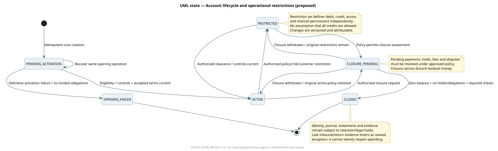

<details>
<summary>Complete PlantUML source</summary>

```plantuml
@startuml
!include ../theme.puml
title UML state — Account lifecycle and operational restrictions (proposed)
hide empty description
[*] --> PENDING_ACTIVATION : Idempotent core creation
PENDING_ACTIVATION --> ACTIVE : Eligibility + controls + accepted terms current
PENDING_ACTIVATION --> OPENING_FAILED : Definitive activation failure / no funded obligations
PENDING_ACTIVATION --> PENDING_ACTIVATION : Recover same opening operation
ACTIVE --> RESTRICTED : Authorized policy/risk/customer restriction
RESTRICTED --> ACTIVE : Authorized clearance / controls current
ACTIVE --> CLOSURE_PENDING : Authorized closure request
RESTRICTED --> CLOSURE_PENDING : Policy permits closure assessment
CLOSURE_PENDING --> ACTIVE : Closure withdrawn / original active policy restored
CLOSURE_PENDING --> RESTRICTED : Closure withdrawn / original restrictions remain
CLOSURE_PENDING --> CLOSED : Zero balance + no holds/obligations + required checks
CLOSED --> [*]
OPENING_FAILED --> [*]
note right of RESTRICTED
  Restriction set defines debit, credit, access
  and channel permissions independently.
  No assumption that all credits are allowed.
  Changes are versioned and attributable.
end note
note right of CLOSURE_PENDING
  Pending payments, holds, fees and disputes
  must be resolved under approved policy.
  Closure cannot discard residual money.
end note
note bottom of CLOSED
  Identity, journal, statements and evidence
  remain subject to retention/legal holds.
  Late inbound/return evidence enters an owned
  exception; it cannot silently reopen spending.
end note
footer FR-ACC-01/06; BR-03/11/12. No inactivity/dormancy regime is inferred from the source.
@enduml
```

</details>

## UML — Exception activity

Case ownership, incomplete evidence, independent approval and immutable corrections; J-06.

[Editable PlantUML](uml/10-exception-activity.puml) · [Open SVG](rendered/10-exception-activity.svg)

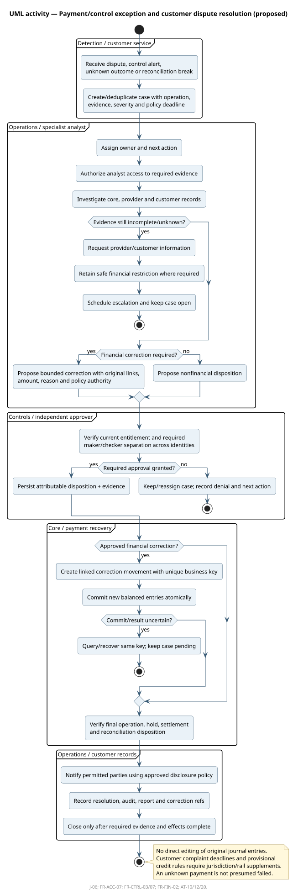

<details>
<summary>Complete PlantUML source</summary>

```plantuml
@startuml
!include ../theme.puml
title UML activity — Payment/control exception and customer dispute resolution (proposed)
start
partition "Detection / customer service" {
  :Receive dispute, control alert,
  unknown outcome or reconciliation break;
  :Create/deduplicate case with operation,
  evidence, severity and policy deadline;
}
partition "Operations / specialist analyst" {
  :Assign owner and next action;
  :Authorize analyst access to required evidence;
  :Investigate core, provider and customer records;
  if (Evidence still incomplete/unknown?) then (yes)
    :Request provider/customer information;
    :Retain safe financial restriction where required;
    :Schedule escalation and keep case open;
    stop
  endif
  if (Financial correction required?) then (yes)
    :Propose bounded correction with original links,
    amount, reason and policy authority;
  else (no)
    :Propose nonfinancial disposition;
  endif
}
partition "Controls / independent approver" {
  :Verify current entitlement and required
  maker/checker separation across identities;
  if (Required approval granted?) then (yes)
    :Persist attributable disposition + evidence;
  else (no)
    :Keep/reassign case; record denial and next action;
    stop
  endif
}
partition "Core / payment recovery" {
  if (Approved financial correction?) then (yes)
    :Create linked correction movement with unique business key;
    :Commit new balanced entries atomically;
    if (Commit/result uncertain?) then (yes)
      :Query/recover same key; keep case pending;
      stop
    endif
  endif
  :Verify final operation, hold, settlement
  and reconciliation disposition;
}
partition "Operations / customer records" {
  :Notify permitted parties using approved disclosure policy;
  :Record resolution, audit, report and correction refs;
  :Close only after required evidence and effects complete;
}
stop
note right
  No direct editing of original journal entries.
  Customer complaint deadlines and provisional
  credit rules require jurisdiction/rail supplements.
  An unknown payment is not presumed failed.
end note
footer J-06; FR-ACC-07; FR-CTRL-03/07; FR-FIN-02; AT-10/12/20.
@enduml
```

</details>

## UML — Event integration components

Outbox/inbox, projection, dead-letter replay, analytics and purpose boundaries; FR-DATA, FR-OPS-03.

[Editable PlantUML](uml/11-event-components.puml) · [Open SVG](rendered/11-event-components.svg)

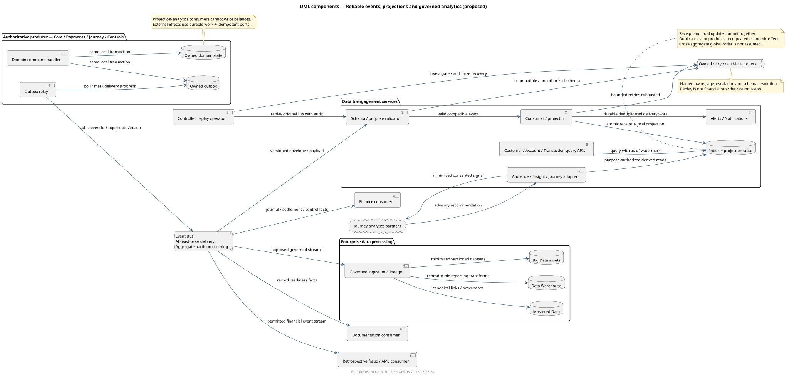

<details>
<summary>Complete PlantUML source</summary>

```plantuml
@startuml
!include ../theme.puml
left to right direction
title UML components — Reliable events, projections and governed analytics (proposed)
package "Authoritative producer — Core / Payments / Journey / Controls" {
  component "Domain command handler" as Handler
  database "Owned domain state" as State
  database "Owned outbox" as Outbox
  component "Outbox relay" as Relay
  Handler --> State : same local transaction
  Handler --> Outbox : same local transaction
  Relay --> Outbox : poll / mark delivery progress
}
queue "Event Bus\nAt-least-once delivery\nAggregate partition ordering" as Bus
Relay --> Bus : stable eventId + aggregateVersion
package "Data & engagement services" {
  component "Schema / purpose validator" as Validator
  component "Consumer / projector" as Projector
  database "Inbox + projection state" as Projection
  component "Customer / Account / Transaction query APIs" as Query
  component "Alerts / Notifications" as Alerts
  component "Audience / Insight / journey adapter" as Audience
  Projector --> Projection : atomic receipt + local projection
  Query --> Projection : query with as-of watermark
  Projector --> Alerts : durable deduplicated delivery work
  Audience --> Projection : purpose-authorized derived reads
}
package "Enterprise data processing" {
  component "Governed ingestion / lineage" as Ingest
  database "Mastered Data" as Master
  database "Data Warehouse" as Warehouse
  database "Big Data assets" as Lake
  Ingest --> Master : canonical links / provenance
  Ingest --> Warehouse : reproducible reporting transforms
  Ingest --> Lake : minimized versioned datasets
}
component "Finance consumer" as Finance
component "Documentation consumer" as Docs
component "Retrospective fraud / AML consumer" as AML
queue "Owned retry / dead-letter queues" as DLQ
component "Controlled replay operator" as Replay
cloud "Journey analytics partners" as Partner

Bus --> Validator : versioned envelope / payload
Validator --> Projector : valid compatible event
Validator --> DLQ : incompatible / unauthorized schema
Bus --> Ingest : approved governed streams
Bus --> Finance : journal / settlement / control facts
Bus --> Docs : record readiness facts
Bus --> AML : permitted financial event stream
Projector --> DLQ : bounded retries exhausted
Replay --> DLQ : investigate / authorize recovery
Replay --> Validator : replay original IDs with audit
Audience --> Partner : minimized consented signal
Partner --> Audience : advisory recommendation
note bottom of State
  Projection/analytics consumers cannot write balances.
  External effects use durable work + idempotent ports.
end note
note bottom of Projection
  Receipt and local update commit together.
  Duplicate event produces no repeated economic effect.
  Cross-aggregate global order is not assumed.
end note
note bottom of DLQ
  Named owner, age, escalation and schema resolution.
  Replay is not financial provider resubmission.
end note
footer FR-CORE-05; FR-DATA-01–05; FR-OPS-03; AT-13/23/28/30.
@enduml
```

</details>

## UML — Authorization sequence

Identity, partner consent, resource entitlement, action-bound proof and authoritative core checks; FR-IAM.

[Editable PlantUML](uml/12-authorization-sequence.puml) · [Open SVG](rendered/12-authorization-sequence.svg)

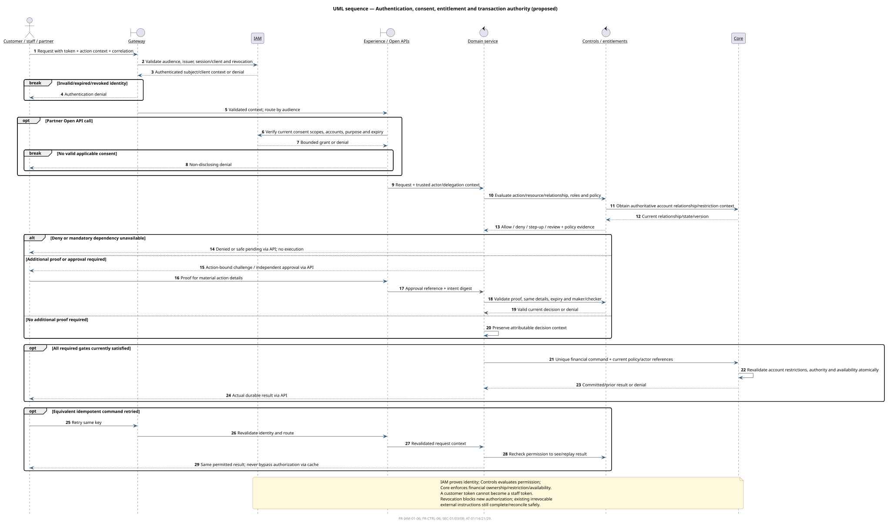

<details>
<summary>Complete PlantUML source</summary>

```plantuml
@startuml
!include ../theme.puml
autonumber
title UML sequence — Authentication, consent, entitlement and transaction authority (proposed)
actor "Customer / staff / partner" as Actor
boundary Gateway
participant IAM
boundary "Experience / Open APIs" as API
control "Domain service" as Domain
control "Controls / entitlements" as Controls
participant Core

Actor -> Gateway : Request with token + action context + correlation
Gateway -> IAM : Validate audience, issuer, session/client and revocation
IAM --> Gateway : Authenticated subject/client context or denial
break Invalid/expired/revoked identity
  Gateway --> Actor : Authentication denial
end
Gateway -> API : Validated context; route by audience
opt Partner Open API call
  API -> IAM : Verify current consent scopes, accounts, purpose and expiry
  IAM --> API : Bounded grant or denial
  break No valid applicable consent
    API --> Actor : Non-disclosing denial
  end
end
API -> Domain : Request + trusted actor/delegation context
Domain -> Controls : Evaluate action/resource/relationship, roles and policy
Controls -> Core : Obtain authoritative account relationship/restriction context
Core --> Controls : Current relationship/state/version
Controls --> Domain : Allow / deny / step-up / review + policy evidence
alt Deny or mandatory dependency unavailable
  Domain --> Actor : Denied or safe pending via API; no execution
else Additional proof or approval required
  Domain --> Actor : Action-bound challenge / independent approval via API
  Actor -> API : Proof for material action details
  API -> Domain : Approval reference + intent digest
  Domain -> Controls : Validate proof, same details, expiry and maker/checker
  Controls --> Domain : Valid current decision or denial
else No additional proof required
  Domain -> Domain : Preserve attributable decision context
end
opt All required gates currently satisfied
  Domain -> Core : Unique financial command + current policy/actor references
  Core -> Core : Revalidate account restrictions, authority and availability atomically
  Core --> Domain : Committed/prior result or denial
  Domain --> Actor : Actual durable result via API
end
opt Equivalent idempotent command retried
  Actor -> Gateway : Retry same key
  Gateway -> API : Revalidate identity and route
  API -> Domain : Revalidated request context
  Domain -> Controls : Recheck permission to see/replay result
  Domain --> Actor : Same permitted result; never bypass authorization via cache
end
note over IAM, Core
  IAM proves identity; Controls evaluates permission;
  Core enforces financial ownership/restriction/availability.
  A customer token cannot become a staff token.
  Revocation blocks new authorization; existing irrevocable
  external instructions still complete/reconcile safely.
end note
footer FR-IAM-01–06; FR-CTRL-06; SEC-01/03/08; AT-01/14/21/29.
@enduml
```

</details>

## UML — Document sequence

Terms acceptance, consistent statements, retrieval authorization and superseding versions; FR-DOC.

[Editable PlantUML](uml/13-document-sequence.puml) · [Open SVG](rendered/13-document-sequence.svg)

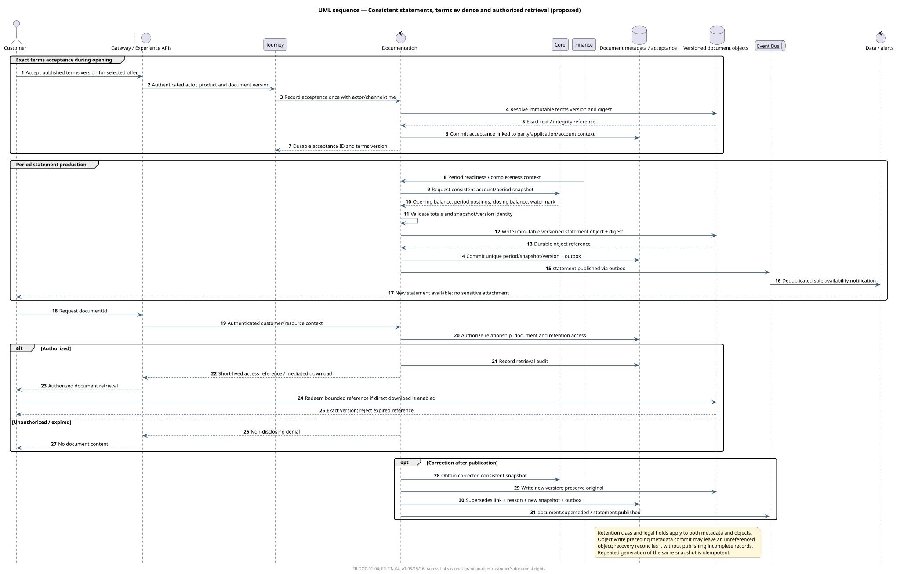

<details>
<summary>Complete PlantUML source</summary>

```plantuml
@startuml
!include ../theme.puml
autonumber
title UML sequence — Consistent statements, terms evidence and authorized retrieval (proposed)
actor Customer
boundary "Gateway / Experience APIs" as API
participant Journey
control Documentation
participant Core
participant Finance
database "Document metadata / acceptance" as Metadata
database "Versioned document objects" as Objects
queue "Event Bus" as Bus
control "Data / alerts" as Alerts

group Exact terms acceptance during opening
  Customer -> API : Accept published terms version for selected offer
  API -> Journey : Authenticated actor, product and document version
  Journey -> Documentation : Record acceptance once with actor/channel/time
  Documentation -> Objects : Resolve immutable terms version and digest
  Objects --> Documentation : Exact text / integrity reference
  Documentation -> Metadata : Commit acceptance linked to party/application/account context
  Documentation --> Journey : Durable acceptance ID and terms version
end
group Period statement production
  Finance -> Documentation : Period readiness / completeness context
  Documentation -> Core : Request consistent account/period snapshot
  Core --> Documentation : Opening balance, period postings, closing balance, watermark
  Documentation -> Documentation : Validate totals and snapshot/version identity
  Documentation -> Objects : Write immutable versioned statement object + digest
  Objects --> Documentation : Durable object reference
  Documentation -> Metadata : Commit unique period/snapshot/version + outbox
  Documentation -> Bus : statement.published via outbox
  Bus -> Alerts : Deduplicated safe availability notification
  Alerts --> Customer : New statement available; no sensitive attachment
end
Customer -> API : Request documentId
API -> Documentation : Authenticated customer/resource context
Documentation -> Metadata : Authorize relationship, document and retention access
alt Authorized
  Documentation -> Metadata : Record retrieval audit
  Documentation --> API : Short-lived access reference / mediated download
  API --> Customer : Authorized document retrieval
  Customer -> Objects : Redeem bounded reference if direct download is enabled
  Objects --> Customer : Exact version; reject expired reference
else Unauthorized / expired
  Documentation --> API : Non-disclosing denial
  API --> Customer : No document content
end
opt Correction after publication
  Documentation -> Core : Obtain corrected consistent snapshot
  Documentation -> Objects : Write new version; preserve original
  Documentation -> Metadata : Supersedes link + reason + new snapshot + outbox
  Documentation -> Bus : document.superseded / statement.published
end
note over Metadata, Objects
  Retention class and legal holds apply to both metadata and objects.
  Object write preceding metadata commit may leave an unreferenced
  object; recovery reconciles it without publishing incomplete records.
  Repeated generation of the same snapshot is idempotent.
end note
footer FR-DOC-01–04; FR-FIN-04; AT-05/15/16. Access links cannot grant another customer's document rights.
@enduml
```

</details>
