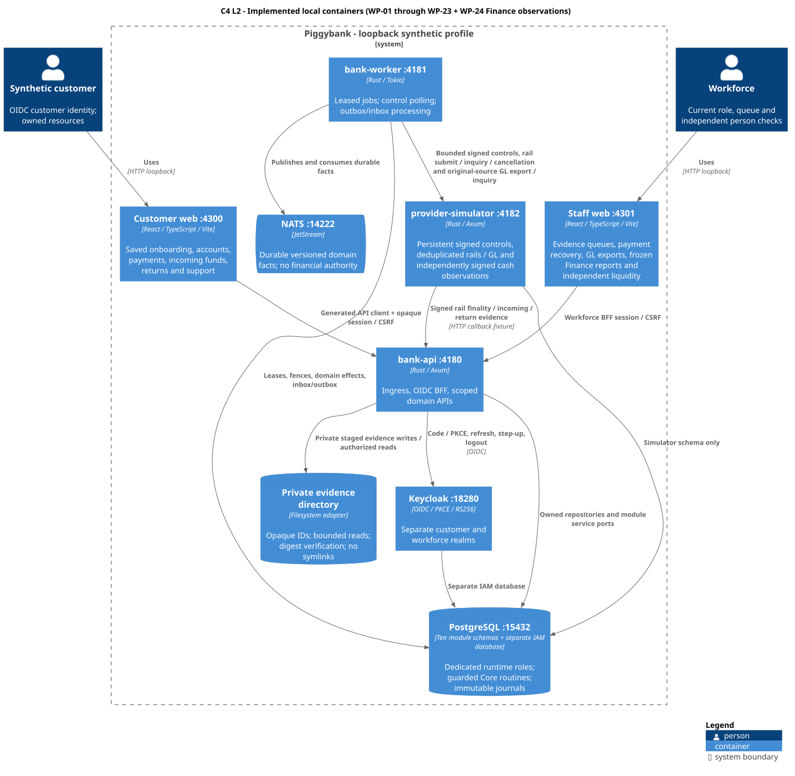
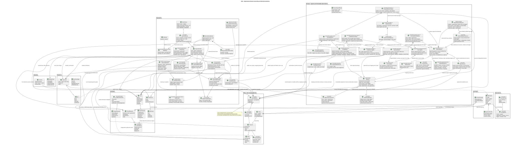

# Implementation status and runtime models

The current additional scope is the [official UI and synthetic investment extension](ui/ARCHITECTURE.md), authorized by the user-provided HTML bundles and UI PRD. See its [implementation steps](ui/IMPLEMENTATION_PLAN.md), [screen coverage](ui/SCREEN_COVERAGE.md) and [local CX walkthrough](ui/LOCAL_CX_TEST.md).

**WP-41** (local capacity template) adds KPI-01..08 as immutable snapshots with explicit numerators, denominators and exclusions, labelled local synthetic. It also makes one measured capacity change: intent creation no longer re-validates its just-validated quote, which took burst intent timeouts from 21,970 to 0 on the same host. The 3x burst is still not demonstrated on one host. ADR 0002 records why the modular monolith and PostgreSQL stay. See [outcomes and capacity](outcomes-capacity.md), [evidence](evidence/WP-41.md), the [acceptance README](../../tests/acceptance/outcomes/README.md) and [ADR 0002](../decisions/0002-capacity-and-service-boundaries.md).

**WP-40** adds liquidity forecasting and controlled finance automation. Forecasts combine the signed liquidity observation, the warehouse watermark and settlement-outflow history at a recorded fact cut, and they reproduce. Only fresh signed evidence counts as confirmed funds. Versioned policies change by maker/checker. A breach restricts new external submissions and opens an owned Finance case; a degraded forecast escalates but can never justify automation. Settlement prefunding is proposed by a confirmed breach, confirmed by a Finance maker, approved by a different approver and booked once by Core within approved limits. Lifts need a current within-limits forecast. See the [specification](liquidity-forecasting.md), [evidence](evidence/WP-40.md), [acceptance README](../../tests/acceptance/liquidity/README.md) and [sequence model](current-liquidity-forecasting.puml).

**WP-39** adds payment routing and approval optimization as a template with two simulated providers for the same rail (`SYNTHETIC_RAIL`, `SYNTHETIC_RAIL_B`). Route policies are versioned and changed by maker/checker with independent approval. Health is measured from recorded simulator outcomes, and every route decision records its policy, rule and shadow choice. Core's route log allows fallback only on signed, single-use proof of non-execution from the current provider, keeping the same operation, amount and hold. Unknown outcomes are inquired, never re-routed. Shadow evaluation requires a minimum sample before activation, and rollback to a previously active version is compatible. Benefit against a real baseline remains pending. See the [specification](payment-routing.md), [evidence](evidence/WP-39.md), [acceptance README](../../tests/acceptance/routing/README.md) and [component model](current-payment-routing.puml).

**WP-38** adds consent-checked audiences, advisory insights and one local journey-partner simulator role (`SIM_JOURNEY`), the template for selected partners. Audiences use minimized warehouse signals and per-audience pseudonymous tokens. Consent is checked at build, export, delivery, receipt and display. Partners can only send advice: anything else is rejected and recorded. Customers see suggestions with a plain why on the Notifications page. Withdrawal hides and withholds without deleting evidence. Outcome reports state their denominators, watermarks and late data. See the [specification](audiences-journeys.md), [evidence](evidence/WP-38.md), [acceptance README](../../tests/acceptance/journeys/README.md) and [sequence model](current-audiences-journeys.puml).

**WP-37** adds a governed warehouse with one local adapter (`LOCAL_WAREHOUSE`), chosen by the user as the template for later analytical adapters. Versioned datasets accept only backward-compatible schema upgrades. Facts are append-only and keyed by economic identity, so replays are duplicates and conflicting content is quarantined. Snapshots are reproducible and record their fact and master-data cuts, schema versions, runs, transform, purpose and adapter. They flag missing or stale sources and conflicts, and reconcile control totals with Core's journal. The Data role has no Core write path. See the [specification](governed-warehouse.md), [evidence](evidence/WP-37.md), [acceptance README](../../tests/acceptance/analytics/README.md), [adapter contract](../../infra/analytics/README.md) and [component model](current-governed-warehouse.puml).

**WP-36** adds one synthetic ACH-style batch credit rail (`SIM_BATCH`), chosen by the user as the template for later rails. It has its own supplement (cutoff, calendar, T+1 settlement, limits, return reasons) and uses the common action-bound approval before any hold. Immutable outbound files go to the network, which sends signed acknowledgements, settlements and returns. Each entry gets one credit and at most one linked return, and late returns are flagged. See the [rail supplement](batch-rail.md), [evidence](evidence/WP-36.md), [acceptance README](../../tests/acceptance/batch/README.md) and [state model](current-batch-rail.puml).

**WP-35** adds an ATM channel against a network simulator role. Signed network messages are limited to the confirmed operations (balance inquiry and cash withdrawal) under per-withdrawal and daily limits. Each authorization is a Core hold, and its completion posts exactly once; duplicates replay the stored response. Reversals release holds, late reversals are flagged, timeouts expire, and settlement files are reconciled item by item. See the [channel supplement](atm-channel.md), [evidence](evidence/WP-35.md), [acceptance README](../../tests/acceptance/atm/README.md) and [lifecycle](current-atm-lifecycle.puml).

**WP-34** adds assisted channels (branch, private banker, call center) as a local synthetic R2 capability. Staff act for a customer only inside a session the customer authorizes in a bank channel. A per-channel policy enables only confirmed operations: reads and protective freezes, with no payments until DEC-09. Every decision is re-checked and recorded. See the [specification](assisted-channels.md), [evidence](evidence/WP-34.md), [acceptance README](../../tests/acceptance/assisted/README.md) and [sequence](current-assisted-session.puml).

**WP-33** adds consented partner APIs and delegated account authority as a local synthetic R2 capability. Registered partner clients come from a separate issuer realm and need maker/checker approval. Customers authorize scoped, expiring, revocable consent in a bank channel, and Controls re-checks it at every decision. The partner contract is versioned with `Sunset` and `Deprecation`, with per-client quotas and HMAC-signed callbacks. Partners can draft payments but never approve them, and customer approval survives revocation (AT-21). Owners can delegate VIEW or PAY-up-to-a-limit access. See the [specification](partner-consents.md), [evidence](evidence/WP-33.md), [acceptance README](../../tests/acceptance/partners/README.md), [sequence](current-partner-consent.puml) and [components](current-partner-components.puml).

**WP-30** qualifies the local single-host environment. It adds a branch-level [acceptance manifest](../../tests/acceptance/manifest.json) (`make acceptance`), a reproducible [load suite](../../tests/load/README.md) with financial invariants and NFR checks (`make test-load`, `make test-load-measured`), and [resilience drills](../../tests/resilience/README.md) D1–D5 (`make test-resilience`, gated in CI). The sustained workload passed. The 5-minute 3x burst fails for payment intents on this host (CF-04). Two serializations found during qualification were fixed: audit streams are now sharded, and the quota row commits in a single statement. See the [qualification report](local-qualification.md) and [evidence](evidence/WP-30.md).

**WP-29** adds a token-protected Prometheus `/metrics` endpoint, on-call paging with acknowledgement and escalation (NFR-10 drill), startup validation of secret files, a migration lock with an expand-only lint, a local CI-equivalent pipeline with sanitized evidence (`make ci`), and a backup/restore drill with invariant verification. See the [specification](operations-tooling.md), the [backup](../runbooks/backup-restore.md), [deployment and upgrade](../runbooks/deployment-upgrades.md) and [on-call](../runbooks/oncall.md) runbooks, the [evidence](evidence/WP-29.md), the [acceptance manifest](../../tests/integration/deployment/README.md) and the [model](current-operations-tooling.puml).

**WP-28** adds issuer-backed account recovery (lost device and credential reset, with risk signals and independent approval), AES-256-GCM sealing of server-held session tokens with a rotatable key ring, privacy restriction and personal-data export, access recertification, a findings register with independent disposition, sensitive-log inspection, a sanitized [threat model](../security/threat-model.md) and an [incident runbook](../runbooks/security-incident.md). See the [specification](security-lifecycle.md), [evidence](evidence/WP-28.md), [acceptance manifest](../../tests/acceptance/security/README.md), [sequence](current-security-recovery.puml) and [domain](current-security-domain.puml).

**WP-27** adds the native mobile app (`apps/mobile`, Expo SDK 54): system-browser PKCE sign-in, Keystore-held rotating refresh tokens, native action-bound step-up, persisted-operation recovery, offline command blocking, a background privacy cover and accessible screens for accounts and onboarding, payments, statements, support and profile. Android emulator evidence is recorded; iOS remains pending. See the [specification](native-mobile.md), [runbook](../runbooks/mobile-development.md), [evidence](evidence/WP-27.md), [acceptance manifest](../../tests/mobile/README.md), [C4](current-mobile-components.puml) and [sequence](current-mobile-step-up.puml).

**WP-26** adds transaction monitoring over durable projected facts (one alert per economic episode, independent disposition), owned data-quality alerts with next actions and balance-safe projection repair, fixed-snapshot operations reports, durable-identifier traces, and deduplicated safe notifications with synthetic capture and outage retries. See the [specification](operations-monitoring.md), [runbook](../runbooks/event-replay.md), [evidence](evidence/WP-26.md), [acceptance manifest](../../tests/acceptance/operations/README.md), [C4](current-operations-components.puml), [sequence](current-operations-monitoring.puml) and [domain](current-operations-domain.puml).

**WP-25** adds readiness-gated monthly statement versions, two-minute single-use retrieval with access evidence, versioned fixture retention, independently released legal holds, evidenced disposal and data-subject requests. See the [specification](statements-retention.md), [runbook](../runbooks/statements-retention.md), [evidence](evidence/WP-25.md), [acceptance manifest](../../tests/acceptance/documents/README.md), [C4](current-statement-components.puml), [sequence](current-statement-lifecycle.puml), [domain](current-statement-domain.puml) and [states](current-statement-states.puml).

The [WP-24 completion evidence](evidence/WP-24-complete.md) records essential financial terms, owner consent, independent activation, native closed-period fee/accrual jobs and linked corrections. The [scope decision](wp24-essential-scope.md), [runbook](../runbooks/periodic-finance-r1.md), [C4](current-periodic-execution-components.puml), [sequence](current-periodic-execution.puml) and [domain](current-periodic-execution-domain.puml) retain exact implementation and deferral boundaries. 

The [execution board](WORK_PACKAGES.md) is generated from the [authoritative backlog](backlog.json). A package is completed only with recorded validation and a linked evidence file. Package counts describe delivery tasks, not a percentage of production readiness.

The [completion status report](COMPLETION_STATUS.md) summarizes the current 24 completed packages, completed essential WP-24 scope, remaining roadmap, latest validation and deployment boundaries.

The [retained preview review increment](periodic-preview-reviews.md) adds explicit customer acknowledgment of exact preview material, immutable private attribution and original native receipt recovery. Its [runbook](../runbooks/periodic-preview-reviews.md) and [evidence](evidence/WP-24-preview-reviews.md) distinguish historical review from financial consent/enrollment and activation. [C4](current-periodic-review-components.puml), [sequence](current-periodic-review.puml) and [domain](current-periodic-review-domain.puml) sources describe the new Documents boundary.

The current local implementation includes Rust/Axum API and worker processes, PostgreSQL module stores, real local OIDC/BFF sessions, exact-money Core ledger, immutable evidence/audit, entitlement and independent approval checks, signed synthetic control providers, persistent onboarding/opening, exact accepted terms, account servicing, data projections and the customer browser client. The workforce portal implements scoped review/evidence/support, independent product/pricing/terms publication and audited role proposals/approvals/revocation. Its verification is recorded in [WP-19 evidence](evidence/WP-19.md). Internal payments, recipient references, exact quotes and action-bound approval are implemented under WP-20. WP-21 adds reserved outgoing SIMULATED rail submission, persistent authenticated provider instructions, inquiry after lost responses, and independent policy/resume controls. WP-22 adds authenticated settlement/release, incoming funds through controlled suspense and principal-capped linked returns. WP-23 adds durable cancellation, bounded original-identity operator recovery and owned reconciliation with retained observations. Finance, statements, notifications, native clients and qualification remain separately tracked. Real providers, market policy and production activation are separate gates.

| Runtime model | Editable notation | Preview |
| --- | --- | --- |
| Current C4 containers and process ownership | [PlantUML](current-containers.puml) | [SVG](current-containers.svg) |
| Current UML domain and authority boundaries | [PlantUML](current-domain.puml) | [SVG](current-domain.svg) |
| Payment components and guarded financial/evidence ports | [PlantUML](current-payment-components.puml) | [SVG](current-payment-components.svg) |
| Action approval, internal posting and lost response recovery | [PlantUML](current-internal-payment.puml) | [SVG](current-internal-payment.svg) |
| Simulated submission, held funds, lost response and pause/resume | [PlantUML](current-external-submission.puml) | [SVG](current-external-submission.svg) |
| Authenticated finality, suspense allocation and linked returns | [PlantUML](current-rail-finality.puml) | [SVG](current-rail-finality.svg) |
| Original-identity inquiry, cancellation and owned reconciliation | [PlantUML](current-payment-recovery.puml) | [SVG](current-payment-recovery.svg) |
| Finance GL export components (WP-24 slice) | [PlantUML](current-finance-components.puml) | [SVG](current-finance-components.svg) |
| Unique GL booking, acknowledgment loss and audited recovery | [PlantUML](current-gl-export.puml) | [SVG](current-gl-export.svg) |
| Consistent Finance observations, frozen lineage and independent liquidity | [PlantUML](current-finance-reporting.puml) | [SVG](current-finance-reporting.svg) |
| Frozen outgoing instruction / clearing / accounting / GL matching | [PlantUML](current-finance-reconciliation.puml) | [SVG](current-finance-reconciliation.svg) |
| Closed multi-file membership, cross-file matching and retained row provenance | [PlantUML](current-finance-group-reconciliation.puml) | [SVG](current-finance-group-reconciliation.svg) |
| Incoming/return matching, native suspense/allocation and original principal cap | [PlantUML](current-finance-credit-reconciliation.puml) | [SVG](current-finance-credit-reconciliation.svg) |
| Independent report revision and original publication recovery | [PlantUML](current-finance-revisions.puml) | [SVG](current-finance-revisions.svg) |
| Saved opening and independent review sequence | [PlantUML](current-opening.puml) | [SVG](current-opening.svg) |
| Historical WP-01 foundation deployment | [PlantUML](local-deployment.puml) | [SVG](local-deployment.svg) |

The [22 target C4/UML views](../diagrams/README.md) preserve the full PRD design. They describe the target product and should be read with this implementation status. `make diagrams` renders both target and implementation views with the pinned PlantUML distribution. `make check` checks both sets without equating valid diagrams with executable product evidence.

Follow the [local development runbook](../runbooks/local-development.md) to start the persistent synthetic environment and reproduce the implementation checks.

The [payment execution specification](payment-execution.md) records the exact internal, external, incoming and return financial and recovery boundaries.

WP-24 is complete within the [essential scope decision](wp24-essential-scope.md); later packages remain planned. Its [Finance execution specification](finance-execution.md) records independently approved charts, sealed GL batches, unique booking, receipt recovery, owned exceptions and generation-fenced operator commands. The [reporting specification](finance-reporting.md) adds consistent Core membership, immutable period controls/source lineage and independently signed liquidity with explicit missing/stale status. [Controlled report revisions](finance-revisions.md) add exact artifact/reason approval, canonical independence, recoverable registration and linear published lineage. The [revision evidence](evidence/WP-24-revisions.md), [reporting evidence](evidence/WP-24-reporting.md), [GL progress evidence](evidence/WP-24-progress.md) and Finance runbooks distinguish these local capabilities from the subsequently completed essential financial lifecycle and deferred production qualification.

Cloud-hosted evaluation packages are available for [GCP and AWS](../deployment/README.md), including complete infrastructure inputs, container builds and operational runbooks. They retain the current loopback synthetic profile; cloud-account application and production qualification remain separate.

The [reconciliation checkpoint evidence](evidence/WP-24-reconciliation.md) records the completed local matching slice. [Outgoing payment reconciliation](finance-reconciliation.md) now matches independent signed clearing files, original instructions, Core accounting and frozen journal/GL observations. Its [operator runbook](../runbooks/finance-reconciliation.md) covers preserved lineage, fee separation and owned discrepancy recovery. [Incoming/return reconciliation](finance-credit-reconciliation.md) now adds separate signed credit files, native suspense/allocation, original settled return linkage and lifetime principal controls; its [operator runbook](../runbooks/finance-credit-reconciliation.md) covers retained observations and owned suspense. [Grouped clearing reconciliation](finance-group-reconciliation.md) now supports closed signed membership across ten files / 1,000 provider rows under existing bank/report bounds. Essential financial execution is completed in [periodic finance R1](periodic-finance-r1.md).

The [incoming/return checkpoint](evidence/WP-24-credit-reconciliation.md) records the separate V1 credit matching implementation, suspense ownership, original settlement/cumulative return controls and its validation boundaries.

The [closed multi-file checkpoint](evidence/WP-24-group-reconciliation.md) records signed set membership, preserved per-file row provenance, 1,000-row boundary behavior and unchanged prior V1 artifacts. Follow the [grouped operator runbook](../runbooks/finance-group-reconciliation.md) for complete preparation/publication/capture/review steps.

The [periodic policy checkpoint](periodic-accounting-policies.md) adds independently approved immutable product-bound policies, complete finite UTC calendars and exact monthly-fee/daily-accrual previews. Its [operator runbook](../runbooks/periodic-accounting-policies.md) includes complete example inputs and expected results. These policies are PREVIEW_ONLY. Subsequent native basis observations and funding-only corrections are implemented separately; the separately approved [financial lifecycle](periodic-finance-r1.md) now implements essential enrollment, account-period finality, native jobs and periodic corrections. The [evidence](evidence/WP-24-periodic-policies.md) records verified behavior and boundaries.

| Periodic policy view | Source | Preview |
| --- | --- | --- |
| Durable approval and native publication receipt | [PlantUML](current-periodic-policies.puml) | [SVG](current-periodic-policies.svg) |
| Immutable policy/calendar/calculation domain | [PlantUML](current-periodic-policy-domain.puml) | [SVG](current-periodic-policy-domain.svg) |

The [controlled funding correction increment](finance-corrections.md) adds exact-source native financial reversal through a separate narrow Core capability. The [runbook](../runbooks/finance-corrections.md) covers original funding identification, independent approval, explicit maker execution, lost-response receipt recovery, held funds and original/correction GL lineage. Its [evidence](evidence/WP-24-corrections.md) distinguishes this completed funding-only scope from the subsequently completed native periodic posting/correction scope.

| Funding correction view | Source | Preview |
| --- | --- | --- |
| Exact approval, financial locks and original receipt recovery | [PlantUML](current-finance-corrections.puml) | [SVG](current-finance-corrections.svg) |
| Frozen source, scope, native receipt and observation domain | [PlantUML](current-finance-correction-domain.puml) | [SVG](current-finance-correction-domain.svg) |

The [native periodic basis increment](periodic-native-basis.md) captures the exact committed business-date journal prefix and account metadata in one native statement snapshot. The [runbook](../runbooks/periodic-native-basis.md) covers capture, original replay, fresh observations, source paging and audit recovery. Open periods are explicitly provisional; ended-period observations do not establish global book close. Captures never post money or enroll accounts. See [checkpoint evidence](evidence/WP-24-native-basis.md).

| Native basis view | Source | Preview |
| --- | --- | --- |
| Native snapshot, original replay and stable audit recovery | [PlantUML](current-periodic-native-basis.puml) | [SVG](current-periodic-native-basis.svg) |
| Immutable basis, original native source and calculation domain | [PlantUML](current-periodic-basis-domain.puml) | [SVG](current-periodic-basis-domain.svg) |

The [audit delivery increment](finance-audit-delivery.md) prevents a damaged pending prefix from starving later events. Native Controls receipt verification gates delivery acknowledgment; original payloads/times remain unchanged. The [operator runbook](../runbooks/finance-audit-delivery.md) covers retained failures, original-identity recovery and verified legacy upgrade. Its [checkpoint evidence](evidence/WP-24-audit-delivery.md) separates audit delivery from Core financial completion.

| Audit delivery view | Source | Preview |
| --- | --- | --- |
| Bounded durable relay and original native confirmation | [PlantUML](current-finance-audit-delivery.puml) | [SVG](current-finance-audit-delivery.svg) |
| Original record, attempts, cursor and immutable receipt domain | [PlantUML](current-finance-audit-domain.puml) | [SVG](current-finance-audit-domain.svg) |

The [customer periodic disclosure increment](customer-periodic-disclosures.md) adds owner-scoped, versioned information derived from exact approved policies/calendars, with stable material digests and saved URLs. The [runbook](../runbooks/customer-periodic-disclosures.md) covers exact review and privacy boundaries; its [evidence](evidence/WP-24-disclosures.md) records checks. Reading does not create consent, enrollment or financial activation.

| Customer disclosure view | Source | Preview |
| --- | --- | --- |
| Customer authority, native policy and versioned renderer components | [PlantUML](current-periodic-disclosures.puml) | [SVG](current-periodic-disclosures.svg) |
| Original material inquiry and stable disclosure digest | [PlantUML](current-periodic-disclosure-read.puml) | [SVG](current-periodic-disclosure-read.svg) |
