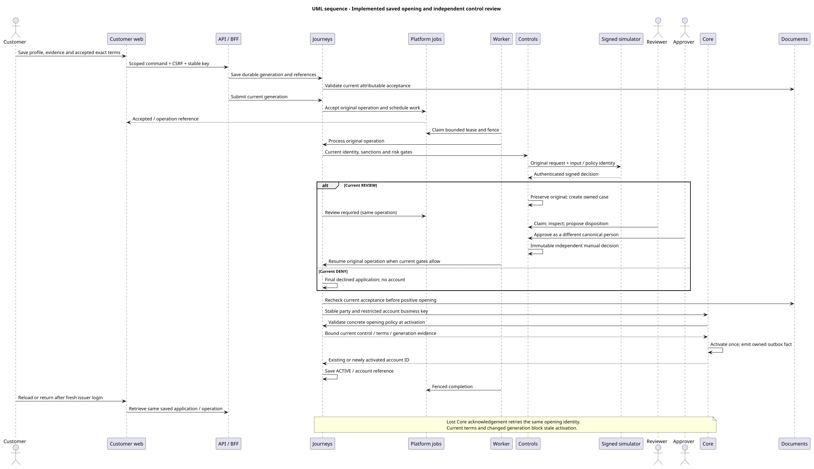

# Implementation status and runtime models

The [execution board](WORK_PACKAGES.md) is generated from the [authoritative backlog](backlog.json). A package is completed only with recorded validation and a linked evidence file. Package counts describe delivery tasks, not a percentage of production readiness.

The current local implementation includes Rust/Axum API and worker processes, PostgreSQL module stores, real local OIDC/BFF sessions, exact-money Core ledger, immutable evidence/audit, entitlement and independent approval checks, signed synthetic control providers, persistent onboarding/opening, exact accepted terms, account servicing, data projections and the customer browser client. The workforce portal implements scoped review/evidence/support, independent product/pricing/terms publication and audited role proposals/approvals/revocation. Its verification is recorded in [WP-19 evidence](evidence/WP-19.md). Internal payments, recipient references, exact quotes and action-bound approval are implemented under WP-20. WP-21 adds reserved outgoing SIMULATED rail submission, persistent authenticated provider instructions, inquiry after lost responses, and independent policy/resume controls. WP-22 adds authenticated settlement/release, incoming funds through controlled suspense and principal-capped linked returns. WP-23 adds durable cancellation, bounded original-identity operator recovery and owned reconciliation with retained observations. Finance, statements, notifications, native clients and qualification remain separately tracked. Real providers, market policy and production activation are separate gates.

| Runtime model | Editable notation | Preview |
| --- | --- | --- |
| Current C4 containers and process ownership | [PlantUML](current-containers.puml) | [SVG](current-containers.svg) |
| Current UML domain and authority boundaries | [PlantUML](current-domain.puml) | [SVG](current-domain.svg) |
| Payment components and guarded financial/evidence ports | [PlantUML](current-payment-components.puml) | [SVG](current-payment-components.svg) |
| Action approval, internal posting and lost response recovery | [PlantUML](current-internal-payment.puml) | [SVG](current-internal-payment.svg) |
| Simulated submission, held funds, lost response and pause/resume | [PlantUML](current-external-submission.puml) | [SVG](current-external-submission.svg) |
| Authenticated finality, suspense allocation and linked returns | [PlantUML](current-rail-finality.puml) | [SVG](current-rail-finality.svg) |
| Original-identity inquiry, cancellation and owned reconciliation | [PlantUML](current-payment-recovery.puml) | [SVG](current-payment-recovery.svg) |
| Finance GL export components (WP-24 slice) | [PlantUML](current-finance-components.puml) | [SVG](current-finance-components.svg) |
| Unique GL booking, acknowledgment loss and audited recovery | [PlantUML](current-gl-export.puml) | [SVG](current-gl-export.svg) |
| Consistent Finance observations, frozen lineage and independent liquidity | [PlantUML](current-finance-reporting.puml) | [SVG](current-finance-reporting.svg) |
| Frozen outgoing instruction / clearing / accounting / GL matching | [PlantUML](current-finance-reconciliation.puml) | [SVG](current-finance-reconciliation.svg) |
| Closed multi-file membership, cross-file matching and retained row provenance | [PlantUML](current-finance-group-reconciliation.puml) | [SVG](current-finance-group-reconciliation.svg) |
| Incoming/return matching, native suspense/allocation and original principal cap | [PlantUML](current-finance-credit-reconciliation.puml) | [SVG](current-finance-credit-reconciliation.svg) |
| Independent report revision and original publication recovery | [PlantUML](current-finance-revisions.puml) | [SVG](current-finance-revisions.svg) |
| Saved opening and independent review sequence | [PlantUML](current-opening.puml) | [SVG](current-opening.svg) |
| Historical WP-01 foundation deployment | [PlantUML](local-deployment.puml) | [SVG](local-deployment.svg) |

The [22 target C4/UML views](../diagrams/README.md) preserve the full PRD design. They describe the target product and should be read with this implementation status. `make diagrams` renders both target and implementation views with the pinned PlantUML distribution. `make check` checks both sets without equating valid diagrams with executable product evidence.

Follow the [local development runbook](../runbooks/local-development.md) to start the persistent synthetic environment and reproduce the implementation checks.

The [payment execution specification](payment-execution.md) records the exact internal, external, incoming and return financial and recovery boundaries.

WP-24 is in progress. Its [Finance execution specification](finance-execution.md) records independently approved charts, sealed GL batches, unique booking, receipt recovery, owned exceptions and generation-fenced operator commands. The [reporting specification](finance-reporting.md) adds consistent Core membership, immutable period controls/source lineage and independently signed liquidity with explicit missing/stale status. [Controlled report revisions](finance-revisions.md) add exact artifact/reason approval, canonical independence, recoverable registration and linear published lineage. The [revision evidence](evidence/WP-24-revisions.md), [reporting evidence](evidence/WP-24-reporting.md), [GL progress evidence](evidence/WP-24-progress.md) and Finance runbooks distinguish these local capabilities from remaining periodic fee/accrual/calendar/correction automation.

Cloud-hosted evaluation packages are available for [GCP and AWS](../deployment/README.md), including complete infrastructure inputs, container builds and operational runbooks. They retain the current loopback synthetic profile; cloud-account application and production qualification remain separate.

The [reconciliation checkpoint evidence](evidence/WP-24-reconciliation.md) records the completed local matching slice. [Outgoing payment reconciliation](finance-reconciliation.md) now matches independent signed clearing files, original instructions, Core accounting and frozen journal/GL observations. Its [operator runbook](../runbooks/finance-reconciliation.md) covers preserved lineage, fee separation and owned discrepancy recovery. [Incoming/return reconciliation](finance-credit-reconciliation.md) now adds separate signed credit files, native suspense/allocation, original settled return linkage and lifetime principal controls; its [operator runbook](../runbooks/finance-credit-reconciliation.md) covers retained observations and owned suspense. [Grouped clearing reconciliation](finance-group-reconciliation.md) now supports closed signed membership across ten files / 1,000 provider rows under existing bank/report bounds. Periodic fee/accrual/calendar/correction execution remains open in WP-24.

The [incoming/return checkpoint](evidence/WP-24-credit-reconciliation.md) records the separate V1 credit matching implementation, suspense ownership, original settlement/cumulative return controls and its validation boundaries.

The [closed multi-file checkpoint](evidence/WP-24-group-reconciliation.md) records signed set membership, preserved per-file row provenance, 1,000-row boundary behavior and unchanged prior V1 artifacts. Follow the [grouped operator runbook](../runbooks/finance-group-reconciliation.md) for complete preparation/publication/capture/review steps.

The [periodic policy checkpoint](periodic-accounting-policies.md) adds independently approved immutable product-bound policies, complete finite UTC calendars and exact monthly-fee/daily-accrual previews. Its [operator runbook](../runbooks/periodic-accounting-policies.md) includes complete example inputs and expected results. These policies are PREVIEW_ONLY. Subsequent native basis observations and funding-only corrections are implemented separately; customer enrollment, authoritative economic finalization, posting jobs and periodic correction commands remain open. The [evidence](evidence/WP-24-periodic-policies.md) records verified behavior and boundaries.

| Periodic policy view | Source | Preview |
| --- | --- | --- |
| Durable approval and native publication receipt | [PlantUML](current-periodic-policies.puml) | [SVG](current-periodic-policies.svg) |
| Immutable policy/calendar/calculation domain | [PlantUML](current-periodic-policy-domain.puml) | [SVG](current-periodic-policy-domain.svg) |

The [controlled funding correction increment](finance-corrections.md) adds exact-source native financial reversal through a separate narrow Core capability. The [runbook](../runbooks/finance-corrections.md) covers original funding identification, independent approval, explicit maker execution, lost-response receipt recovery, held funds and original/correction GL lineage. Its [evidence](evidence/WP-24-corrections.md) distinguishes this completed funding-only scope from periodic posting and future periodic correction work.

| Funding correction view | Source | Preview |
| --- | --- | --- |
| Exact approval, financial locks and original receipt recovery | [PlantUML](current-finance-corrections.puml) | [SVG](current-finance-corrections.svg) |
| Frozen source, scope, native receipt and observation domain | [PlantUML](current-finance-correction-domain.puml) | [SVG](current-finance-correction-domain.svg) |

The [native periodic basis increment](periodic-native-basis.md) captures the exact committed business-date journal prefix and account metadata in one native statement snapshot. The [runbook](../runbooks/periodic-native-basis.md) covers capture, original replay, fresh observations, source paging and audit recovery. Open periods are explicitly provisional; ended-period observations do not establish global book close. Captures never post money or enroll accounts. See [checkpoint evidence](evidence/WP-24-native-basis.md).

| Native basis view | Source | Preview |
| --- | --- | --- |
| Native snapshot, original replay and stable audit recovery | [PlantUML](current-periodic-native-basis.puml) | [SVG](current-periodic-native-basis.svg) |
| Immutable basis, original native source and calculation domain | [PlantUML](current-periodic-basis-domain.puml) | [SVG](current-periodic-basis-domain.svg) |
